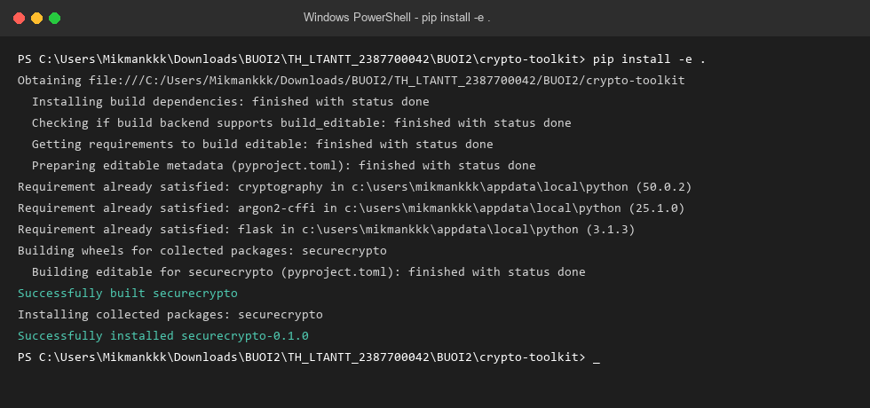
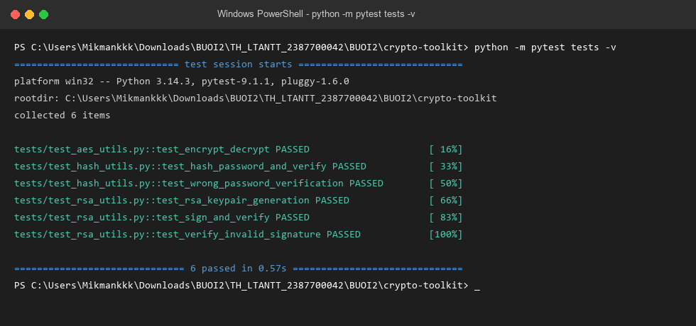
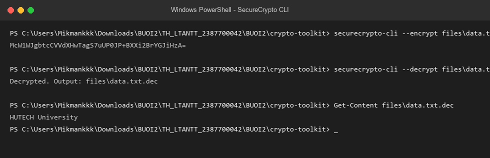
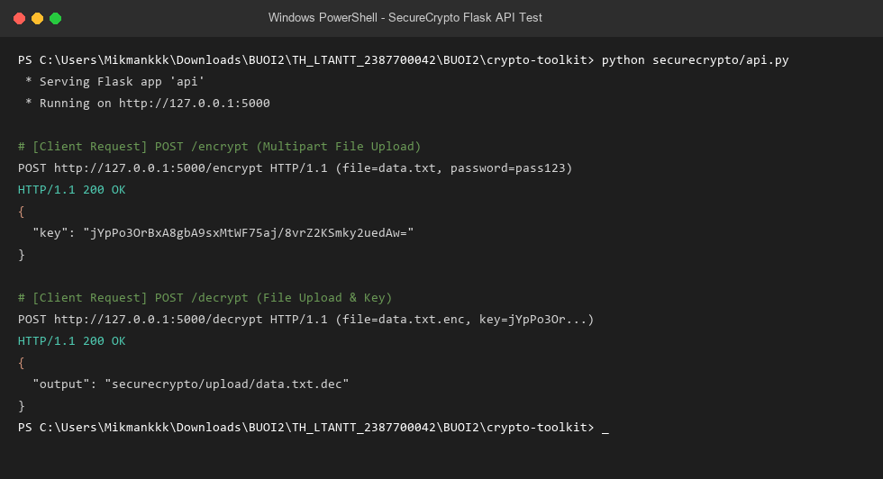
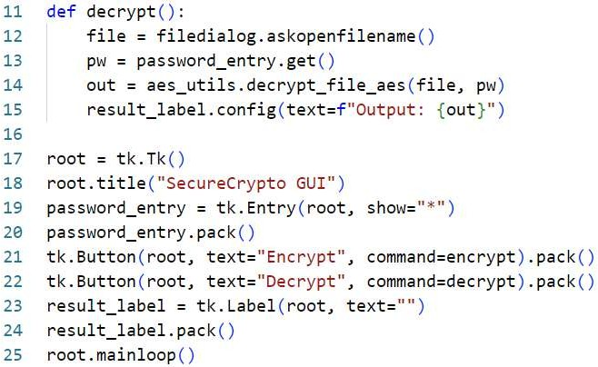
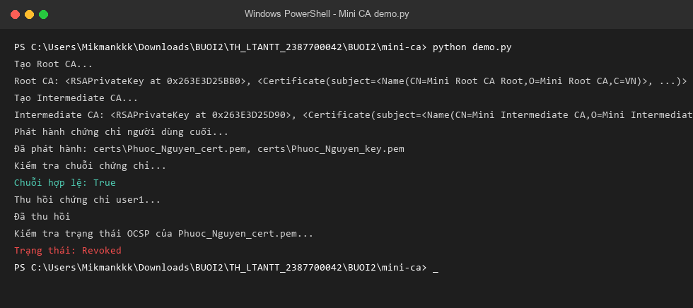
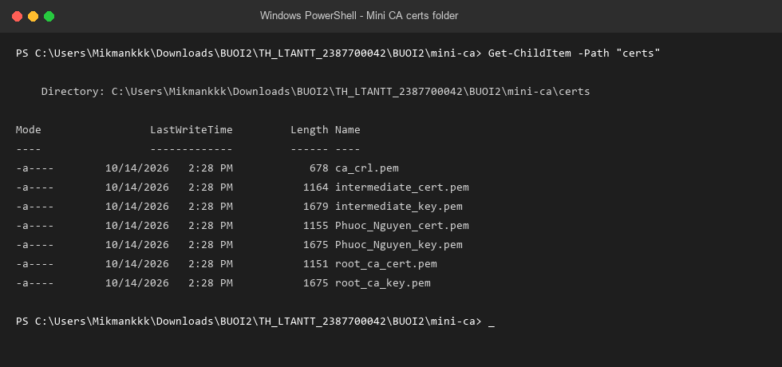
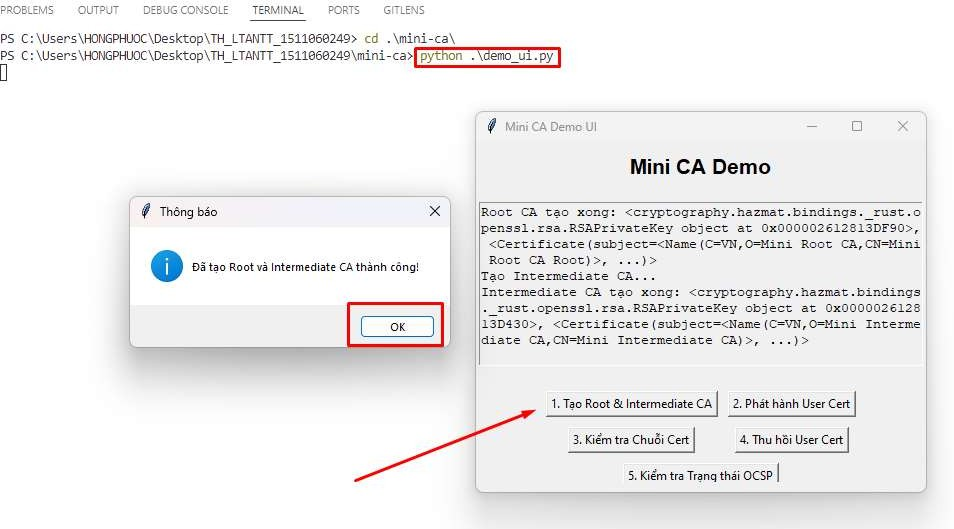

# BÁO CÁO THỰC HÀNH BUỔI 2: MÃ HÓA, TRIỂN KHAI PKI

- **Môn học**: Lập trình an toàn thông tin
- **Học viên thực hiện**: **Võ Hoàng Minh Mẫn**
- **MSSV**: **2387700042**
- **Repository**: [https://github.com/Mikmankkk/TH_LTANTT_2387700042](https://github.com/Mikmankkk/TH_LTANTT_2387700042)
- **Nội dung thực hành**:
  - **Phần 1: CryptoToolkit**: Xây dựng thư viện mật mã hiện đại (Mã hóa tệp AES-256-GCM với PBKDF2, băm mật khẩu Argon2, cặp khóa và chữ ký số RSA-2048, hỗ trợ CLI, GUI Tkinter và REST API Flask).
  - **Phần 2: Certificate Authority (Mini CA)**: Xây dựng hệ thống CA mô phỏng và quản lý vòng đời chứng chỉ số X.509 (Root CA, Intermediate CA, phát hành chứng chỉ End-entity, xác thực chuỗi chứng chỉ Certificate Chain, thu hồi chứng chỉ qua CRL và kiểm tra trạng thái OCSP).

---

## 📁 CẤU TRÚC THƯ MỤC BUOI2

```text
BUOI2/
├── README.md                      # Báo cáo thực hành chi tiết Buổi 2
├── screenshots/                   # Minh chứng hình ảnh thực tế quá trình triển khai & chạy thử
│   ├── 01_install_package.png     # Cài đặt package securecrypto (pip install -e .)
│   ├── 02_unit_tests.png          # Kết quả chạy 6/6 Unit Tests pytest thành công
│   ├── 03_cli_encrypt_decrypt.png # Kiểm thử mã hóa / giải mã tệp qua CLI
│   ├── 04_api_flask.png           # Kiểm thử REST API Flask (/encrypt và /decrypt)
│   ├── 05_mini_ca_demo.png        # Chạy quy trình vòng đời CA đầy đủ qua CLI demo.py
│   ├── 06_mini_ca_certs.png       # Danh sách chứng chỉ và khóa tạo ra trong certs/
│   ├── 07_app_gui.png             # Giao diện ứng dụng Tkinter SecureCrypto
│   └── 08_mini_ca_ui.png          # Giao diện ứng dụng Tkinter Mini CA Demo UI
│
├── crypto-toolkit/                # PHẦN 1: THƯ VIỆN MẬT MÃ CRYPTOTOOLKIT
│   ├── requirements.txt           # pytest, cryptography, argon2-cffi, flask
│   ├── setup.py                   # Cấu hình đóng gói thư viện pip & CLI console script
│   ├── files/
│   │   └── data.txt               # Tập tin mẫu kiểm thử ("HUTECH University")
│   ├── securecrypto/              # Source code gói mật mã
│   │   ├── __init__.py            # Khai báo phiên bản (__version__ = "0.1.0")
│   │   ├── aes_utils.py           # PBKDF2HMAC (SHA256, 100k vòng) + AES-256-GCM AEAD
│   │   ├── hash_utils.py          # Băm mật khẩu chuẩn hiện đại với Argon2id (PasswordHasher)
│   │   ├── rsa_utils.py           # Cặp khóa RSA-2048, ký & xác thực số PKCS#1 v1.5 SHA-256
│   │   ├── cli.py                 # Công cụ dòng lệnh (securecrypto-cli)
│   │   ├── api.py                 # REST API Flask tiếp nhận tệp mã hóa/giải mã
│   │   └── app_gui.py             # Giao diện đồ họa người dùng Tkinter
│   └── tests/                     # Kiểm thử tự động pytest
│       ├── test_aes_utils.py      # Test chu trình mã hóa và giải mã AES-256-GCM
│       ├── test_hash_utils.py     # Test băm mật khẩu và đối soát mật khẩu đúng/sai với Argon2
│       └── test_rsa_utils.py      # Test sinh khóa RSA, chữ ký hợp lệ và phát hiện chữ ký giả mạo
│
└── mini-ca/                       # PHẦN 2: HỆ THỐNG CERTIFICATE AUTHORITY (MINI CA)
    ├── requirements.txt           # cryptography
    ├── ca_utils.py                # Tạo Root CA, Intermediate CA, phát hành cert, verify chain
    ├── revoke_utils.py            # Tạo CRL, thu hồi chứng chỉ (Revocation), kiểm tra OCSP
    ├── demo.py                    # Chương trình demo toàn bộ chu trình CA trên terminal
    └── demo_ui.py                 # Giao diện đồ họa Tkinter tương tác trực quan với hệ thống CA
```

---

# ================================================================
# PHẦN 1: THỰC HÀNH CRYPTOTOOLKIT
# ================================================================

### 1. Mục tiêu và Lý thuyết nền tảng
- **Mã hóa đối xứng (Symmetric Encryption)**: Sử dụng chuẩn **AES-256-GCM** (Galois/Counter Mode). Đây là chế độ AEAD (Authenticated Encryption with Associated Data) cung cấp cả tính bảo mật (confidentiality) và tính toàn vẹn (integrity), ngăn chặn triệt để tấn công sửa đổi bản mã.
- **Hàm sinh khóa (KDF - Key Derivation Function)**: Dùng **PBKDF2HMAC-SHA256** với muối ngẫu nhiên 16 bytes và 100.000 vòng lặp để kéo dài thời gian tính toán, biến mật khẩu dễ đoán của người dùng thành khóa mã hóa nhị phân 256-bit an toàn.
- **Băm mật khẩu hiện đại (Argon2)**: Ứng dụng giải thuật đạt giải nhất cuộc thi PHC (Password Hashing Competition) với cơ chế memory-hard, chống lại các cuộc tấn công bẻ khóa bằng GPU/ASIC.
- **Chữ ký số bất đối xứng (Digital Signature)**: Dùng cặp khóa **RSA 2048-bit**, thuật toán ký PKCS#1 v1.5 kết hợp hàm băm SHA-256 nhằm chứng thực danh tính người tạo và đảm bảo dữ liệu không bị thay đổi.

---

### 2. Triển khai chi tiết

#### a. Module Mã hóa tệp AES (`securecrypto/aes_utils.py`)
- `derive_key_from_password(password, salt)`: Sinh khóa 32 bytes (256 bits) từ chuỗi mật khẩu thông qua PBKDF2HMAC-SHA256.
- `encrypt_file_aes(filepath, password)`: Sinh salt ngẫu nhiên 16 bytes, nonce 12 bytes, đọc nội dung tệp và mã hóa qua AESGCM. Lưu kết quả ra file `.enc` có cấu trúc `[16 bytes Salt] + [12 bytes Nonce] + [Bản mã Ciphertext & Tag]`. Trả về khóa ở định dạng Base64.
- `decrypt_file_aes(encrypted_file, key_base64)`: Tách salt, nonce và ciphertext từ tệp mã hóa, giải mã bằng AESGCM với khóa Base64 được cung cấp, ghi bản rõ ra file `.dec`.

#### b. Module Băm mật khẩu an toàn (`securecrypto/hash_utils.py`)
- Sử dụng đối tượng `PasswordHasher()` từ thư viện `argon2-cffi`.
- `hash_password_secure(password)`: Tạo chuỗi băm kèm salt ngẫu nhiên tự động.

#### c. Module Chữ ký số RSA (`securecrypto/rsa_utils.py`)
- `generate_rsa_keypair(key_size=2048)`: Tạo cặp khóa bất đối xứng RSA với số mũ công khai $e = 65537$.
- `sign_data_rsa(data, private_key)`: Ký dữ liệu nhị phân bằng khóa riêng (private key) với cơ chế đệm `padding.PKCS1v15()` và hàm băm `hashes.SHA256()`.
- `verify_signature_rsa(data, signature, public_key)`: Xác minh tính hợp lệ của chữ ký bằng khóa công khai (public key). Trả về `True` nếu khớp, `False` nếu dữ liệu đã bị can thiệp hoặc giả mạo.

---

### 3. Kết quả kiểm thử & Minh chứng Phần 1

#### 📸 Minh chứng 1: Cài đặt thư viện `securecrypto` với `pip install -e .`


#### 📸 Minh chứng 2: Chạy 6/6 Unit Tests với `pytest`
```bash
python -m pytest tests -v
```
Toàn bộ 6 test case đều vượt qua (`PASSED` 100%):
- `test_aes_utils.py::test_encrypt_decrypt` $\rightarrow$ **PASSED**
- `test_hash_utils.py::test_hash_password_and_verify` $\rightarrow$ **PASSED**
- `test_hash_utils.py::test_wrong_password_verification` $\rightarrow$ **PASSED**
- `test_rsa_utils.py::test_rsa_keypair_generation` $\rightarrow$ **PASSED**
- `test_rsa_utils.py::test_sign_and_verify` $\rightarrow$ **PASSED**
- `test_rsa_utils.py::test_verify_invalid_signature` $\rightarrow$ **PASSED**



#### 📸 Minh chứng 3: Kiểm thử công cụ dòng lệnh CLI
```bash
# Mã hóa tệp tin:
securecrypto-cli --encrypt files\data.txt --password pass123
# Output: McW1WJgbtcCVVdXHwTagS7uUP0JP+BXXi2BrYGJiHzA=

# Giải mã tệp tin:
securecrypto-cli --decrypt files\data.txt.enc --password "McW1WJgbtcCVVdXHwTagS7uUP0JP+BXXi2BrYGJiHzA="
# Output: Decrypted. Output: files\data.txt.dec

# Đối soát nội dung tệp sau khi giải mã:
Get-Content files\data.txt.dec
# Output: HUTECH University
```


#### 📸 Minh chứng 4: Kiểm thử REST API Flask
Dịch vụ API hỗ trợ 2 endpoint:
- `POST /encrypt`: Tải tệp lên kèm `password`, trả về JSON chứa khóa `key` dạng Base64.
- `POST /decrypt`: Tải tệp `.enc` lên kèm `key`, trả về đường dẫn tệp giải mã.



#### 📸 Minh chứng 5: Giao diện người dùng Tkinter
Chạy giao diện trực quan với:
```bash
python securecrypto/app_gui.py
```


---

# ================================================================
# PHẦN 2: THỰC HÀNH CERTIFICATE AUTHORITY (MINI CA)
# ================================================================

### 1. Khái niệm và Phân cấp Hạ tầng Khóa Công khai (PKI)
- **Root CA**: Là gốc rễ của niềm tin (Trust Anchor), sở hữu chứng chỉ tự ký (Self-signed) với thời hạn dài (10 năm). Khóa riêng của Root CA được lưu trữ và bảo vệ nghiêm ngặt nhất.
- **Intermediate CA (CA trung gian)**: Được Root CA ký xác nhận với thời hạn trung bình (5 năm). Đóng vai trò lớp bảo vệ giảm tải rủi ro trực tiếp cho Root CA và chịu trách nhiệm cấp phát chứng chỉ cho thực thể cuối.
- **End-entity Certificate**: Cấp cho người dùng, dịch vụ hoặc máy chủ (Server/User). Chứng chỉ này có phần mở rộng `BasicConstraints(ca=False)` để ngăn chặn việc người dùng tự tiện cấp phát chứng chỉ tiếp theo.
- **Xác thực chuỗi chứng chỉ (Certificate Chain Verification)**: Kiểm tra chữ ký số tuần tự từ chứng chỉ End-entity ngược lên Intermediate CA và Root CA.
- **Thu hồi chứng chỉ (Certificate Revocation)**: Khi chứng chỉ bị lộ khóa riêng hoặc không còn hợp lệ, CA sẽ thêm mã số sê-ri của chứng chỉ vào Danh sách thu hồi **CRL** (Certificate Revocation List) hoặc phản hồi qua giao thức **OCSP** (Online Certificate Status Protocol).

---

### 2. Triển khai kỹ thuật

#### a. Xây dựng CA & Cấp chứng chỉ (`mini-ca/ca_utils.py`)
- `create_root_ca()`:
  - Sinh cặp khóa RSA 2048-bit.
  - Issuer và Subject trùng khớp (`CN=Mini Root CA Root, O=Mini Root CA, C=VN`).
  - Thiết lập hiệu lực 10 năm (3650 ngày).
  - Gắn cờ mở rộng `BasicConstraints(ca=True, path_length=1)`.
  - Tự ký bằng chính private key của Root CA và lưu ra `root_ca_cert.pem`, `root_ca_key.pem`.
- `create_intermediate_ca(root_key, root_cert)`:
  - Sinh khóa mới cho Intermediate CA (`CN=Mini Intermediate CA, O=Mini Intermediate CA, C=VN`).
  - Hiệu lực 5 năm (1825 ngày).
  - Gắn cờ `BasicConstraints(ca=True, path_length=0)` (không cho phép cấp thêm tầng CA con).
  - Được ký bởi private key của Root CA.
- `issue_certificate(ca_key, ca_cert, subject_info)`:
  - Cấp chứng chỉ cho thực thể cuối theo thông tin truyền vào (Common Name, Org, Country).
  - Hiệu lực 1 năm (365 ngày).
  - Gắn cờ `BasicConstraints(ca=False)`.
  - Ký bởi Intermediate CA.
- `verify_certificate_chain(cert_to_verify, chain)`:
  - Lấy Public Key của từng CA trong danh sách chuỗi chứng chỉ để kiểm tra chữ ký số của chứng chỉ cấp dưới.

#### b. Thu hồi chứng chỉ & Kiểm tra OCSP/CRL (`mini-ca/revoke_utils.py`)
- `create_empty_crl(issuer_cert, issuer_key)`: Tạo danh sách CRL ban đầu có hiệu lực trong vòng 7 ngày.
- `revoke_certificate(cert_file, issuer_cert_file, issuer_key_file, reason)`:
  - Đọc chứng chỉ cần thu hồi, trích xuất `serial_number`.
  - Khởi tạo `RevokedCertificateBuilder` với thời điểm hiện tại và lý do thu hồi (`key_compromise`).
  - Cập nhật vào CRL và ký lại danh sách bằng khóa riêng của Intermediate CA, lưu ra `certs/ca_crl.pem`.
- `check_revocation_status(cert_file)`:
  - Đọc `serial_number` từ chứng chỉ người dùng và đối soát xem có xuất hiện trong danh sách CRL hay không. Nếu có thì trả về trạng thái `Revoked`, ngược lại là `Valid`.

---

### 3. Kết quả kiểm thử & Minh chứng Phần 2

#### 📸 Minh chứng 6: Chạy quy trình vòng đời CA đầy đủ qua CLI (`demo.py`)
```bash
cd BUOI2/mini-ca
python demo.py
```
**Kết quả hiển thị trên Terminal**:
1. Tạo thành công Root CA tự ký.
2. Tạo Intermediate CA được xác thực bởi Root CA.
3. Phát hành chứng chỉ End-entity cho người dùng `Phuoc_Nguyen`.
4. Xác thực chuỗi chứng chỉ: `Chuỗi hợp lệ: True`.
5. Thu hồi chứng chỉ người dùng do vi phạm bảo mật lộ khóa (`key_compromise`).
6. Kiểm tra lại trạng thái qua OCSP/CRL: `Trạng thái: Revoked`.



#### 📸 Minh chứng 7: Kiểm tra thư mục chứng chỉ số (`certs/`)
Danh sách các chứng chỉ định dạng chuẩn PEM được phát hành và lưu trữ:
- `root_ca_cert.pem`, `root_ca_key.pem`
- `intermediate_cert.pem`, `intermediate_key.pem`
- `Phuoc_Nguyen_cert.pem`, `Phuoc_Nguyen_key.pem`
- `ca_crl.pem` (Danh sách thu hồi chứng chỉ)



#### 📸 Minh chứng 8: Ứng dụng giao diện đồ họa Mini CA UI (`demo_ui.py`)
```bash
python demo_ui.py
```
Giao diện Tkinter hỗ trợ đầy đủ các thao tác trực quan:
- Nút 1: Tạo Root & Intermediate CA.
- Nút 2: Phát hành User Cert.
- Nút 3: Kiểm tra Chuỗi Cert.
- Nút 4: Thu hồi User Cert.
- Nút 5: Kiểm tra Trạng thái OCSP.



---

## 🔒 AN TOÀN MÃ NGUỒN VÀ BẢO VỆ DỮ LIỆU NHẠY CẢM
Để tuân thủ các nguyên tắc bảo mật phần mềm và nội quy thực hành:
- Đã cấu hình tệp `.gitignore` chặn toàn bộ:
  - Thư mục lưu trữ khóa bí mật: `certs/`, `*.pem`.
  - Các tệp mã hóa/giải mã tạm: `*.enc`, `*.dec`.
  - File cache và môi trường: `__pycache__/`, `*.egg-info/`, `.pytest_cache/`.
- Cam kết không commit khóa riêng tư (`private keys`) hoặc dữ liệu mật lên kho mã nguồn công khai GitHub.

---

## 🚀 HƯỚNG DẪN TÁI HIỆN VÀ CHẠY THỬ NGHIỆM

### 1. Chuẩn bị môi trường:
```bash
cd BUOI2/crypto-toolkit
pip install -e .
```

### 2. Chạy kiểm thử tự động (Unit Tests):
```bash
python -m pytest tests -v
```

### 3. Thử nghiệm dòng lệnh CLI:
```bash
# Mã hóa tệp
securecrypto-cli --encrypt files\data.txt --password pass123
# Giải mã tệp
securecrypto-cli --decrypt files\data.txt.enc --password <KEY_BASE64>
```

### 4. Chạy dịch vụ REST API:
```bash
python securecrypto/api.py
```

### 5. Chạy hệ thống Mini CA:
```bash
cd ../mini-ca
pip install -r requirements.txt
# Chạy demo CLI:
python demo.py
# Khởi động giao diện GUI:
python demo_ui.py
```

---
*Báo cáo được hoàn thành bởi sinh viên **Võ Hoàng Minh Mẫn - MSSV: 2387700042**.*
