# BÁO CÁO THỰC HÀNH BUOI3: BẢO MẬT MẠNG MÁY TÍNH & TRINH SÁT HỆ THỐNG

- **Môn học**: Thực hành Lập trình An toàn Thông tin / Bảo mật Mạng Máy tính
- **Học viên thực hiện**: **VÕ HOÀNG MINH MẪN**
- **Mã số sinh viên (MSSV)**: **2387700042**
- **Repository GitHub**: [https://github.com/Mikmankkk/TH_LTANTT_2387700042](https://github.com/Mikmankkk/TH_LTANTT_2387700042)
- **Ngày thực hiện**: Tháng 10 / 2026

---

## 📑 MỤC LỤC
1. [Tổng quan nội dung buổi thực hành](#1-tổng-quan-nội-dung-buổi-thực-hành)
2. [Cấu trúc thư mục BUOI3](#2-cấu-trúc-thư-mục-buoi3)
3. [BÀI THỰC HÀNH 1: SECURECHAT (LẬP TRÌNH SOCKET BẢO MẬT)](#3-bài-thực-hành-1-securechat-lập-trình-socket-bảo-mật)
   - [3.1 Cơ sở lý thuyết SSL/TLS và mã hóa dữ liệu](#31-cơ-sở-lý-thuyết-ssltls-và-mã-hóa-dữ-liệu)
   - [3.2 Thiết kế kiến trúc hệ thống SecureChat](#32-thiết-kế-kiến-trúc-hệ-thống-securechat)
   - [3.3 Triển khai mã nguồn chi tiết](#33-triển-khai-mã-nguồn-chi-tiết)
   - [3.4 Hình ảnh minh chứng thực thi trong CMD / Terminal](#34-hình-ảnh-minh-chứng-thực-thi-trong-cmd--terminal)
4. [BÀI THỰC HÀNH 2: NETRECON (BỘ CÔNG CỤ TRINH SÁT VÀ QUÉT MẠNG)](#4-bài-thực-hành-2-netrecon-bộ-công-cụ-trinh-sát-và-quét-mạng)
   - [4.1 Cơ sở lý thuyết quét cổng và nhận dạng dịch vụ](#41-cơ-sở-lý-thuyết-quét-cổng-và-nhận-dạng-dịch-vụ)
   - [4.2 Thiết kế kiến trúc NetRecon Toolkit](#42-thiết-kế-kiến-trúc-netrecon-toolkit)
   - [4.3 Triển khai mã nguồn chi tiết](#43-triển-khai-mã-nguồn-chi-tiết)
   - [4.4 Hình ảnh minh chứng thực thi trong CMD / Terminal & Web](#44-hình-ảnh-minh-chứng-thực-thi-trong-cmd--terminal--web)
5. [Phân tích bảo mật và các biện pháp tăng cường (Security Hardening)](#5-phân-tích-bảo-mật-và-các-biện-pháp-tăng-cường-security-hardening)
6. [Kết luận và nghiệm thu kết quả](#6-kết-luận-và-nghiệm-thu-kết-quả)

---

## 1. TỔNG QUAN NỘI DUNG BUỔI THỰC HÀNH

Buổi thực hành số 3 trang bị kiến thức chuyên sâu và kỹ năng thực chiến về **Bảo mật mạng máy tính**, tập trung vào hai mảng cốt lõi:
1. **Phòng thủ & Giao tiếp bảo mật (Defensive / Secure Communication)**:
   - Xây dựng ứng dụng chat phân tán bảo mật **SecureChat** hỗ trợ mã hóa 2 lớp:
     - Lớp kênh truyền: Xác thực chứng chỉ 2 chiều (Mutual TLS / mTLS) bằng OpenSSL, bắt buộc TLS 1.2+ nhằm phòng chống tấn công Man-In-The-Middle (MITM).
     - Lớp nội dung: Mã hóa đầu-cuối (End-to-End Encryption - E2EE) bằng thuật toán mã hóa đối xứng **AES-256-CBC** với đệm chuẩn **PKCS#7**.
     - Đa luồng xử lý (`threading`), quản lý phiên (`ConnectionManager`) và quản lý phòng chat (`RoomManager`).
2. **Tấn công trinh sát & Phân tích hệ thống mạng (Offensive / Network Reconnaissance)**:
   - Phát triển bộ công cụ thám mã mạng **NetRecon**:
     - Quét cổng TCP bất đồng bộ (`asyncio`) kiểm soát tốc độ (`rate limiting` qua Semaphore).
     - Nhận diện phiên bản dịch vụ (`Service Fingerprinting`) thông qua tích hợp **Nmap** (`-sV`).
     - Thu thập biểu ngữ dịch vụ thời gian thực (`Banner Grabbing`).
     - Lập bản đồ topo mạng cục bộ (`Network Mapping` thông qua ARP cache).
     - Tra cứu và cảnh báo mã lỗ hổng bảo mật phổ biến (`CVE Vulnerability Checker`).
     - Lọc danh sách mục tiêu theo Whitelist / Blacklist.
     - Tích hợp 2 giao diện: Giao diện dòng lệnh **CLI** (Click) và giao diện Web trực quan (**Flask + HTMX**), hỗ trợ gửi kết quả tự động qua email (SMTP SSL).

---

## 2. CẤU TRÚC THƯ MỤC BUOI3

```text
BUOI3/
├── README.md                              # Báo cáo chi tiết và ảnh minh chứng BUOI3
├── screenshots/                           # Thư mục lưu trữ ảnh chụp màn hình minh chứng
│   ├── generate_all_screenshots.py        # Script tạo minh chứng chuẩn nét cao
│   └── images/                            # 15 ảnh chụp màn hình thực tế từ Terminal / Web
│       ├── 01_openssl_check.png
│       ├── 02_make_certs.png
│       ├── 03_certs_tree.png
│       ├── 04_secure_chat_single.png
│       ├── 05_secure_chat_multi.png
│       ├── 06_git_commit_secure_chat.png
│       ├── 07_nmap_check.png
│       ├── 08_netrecon_setup.png
│       ├── 09_cli_port_scan.png
│       ├── 10_cli_mode_all.png
│       ├── 11_web_app_run.png
│       ├── 12_web_ui_form.png
│       ├── 13_web_ui_results.png
│       ├── 14_email_report.png
│       └── 15_git_commit_netrecon.png
│
├── secure-chat/                           # Ứng dụng chat bảo mật Socket SSL/TLS & AES
│   ├── openssl.cnf                        # Cấu hình OpenSSL cho Root CA
│   ├── make-certs.bat                     # Kịch bản tự động sinh chứng chỉ số CA, Server, Client
│   ├── message_encryption.py              # Lớp mã hóa AES-256-CBC, PKCS7 Padding
│   ├── connection_manager.py              # Quản lý Socket client và khóa bí mật
│   ├── room_manager.py                    # Quản lý room và broadcast phòng chat
│   ├── server.py                          # Socket Server SSL/TLS đa luồng
│   ├── client.py                          # Socket Client SSL/TLS đa nhiệm
│   └── certs/                             # Thư mục chứa chứng chỉ số (được gitignore)
│       ├── ca/ (ca.key, ca.crt)
│       ├── server/ (server.key, server.csr, server.crt)
│       └── client/ (client.key, client.csr, client.crt)
│
└── netrecon/                              # Bộ công cụ quét và khám phá mạng NetRecon
    ├── requirements.txt                   # Danh sách thư viện: flask, click, python-dotenv, ...
    ├── .env                               # Biến môi trường cấu hình SMTP (gitignore)
    ├── .env.example                       # File mẫu hướng dẫn cấu hình
    ├── cli.py                             # Giao diện dòng lệnh CLI (Click)
    ├── app.py                             # Máy chủ Flask Web UI tích hợp HTMX
    ├── netrecon.log                       # Nhật ký kiểm toán ghi lại mọi hoạt động quét
    ├── modules/                           # Các module trinh sát mạng lõi
    │   ├── __init__.py
    │   ├── banner_grabber.py              # Thu thập banner dịch vụ
    │   ├── email_sender.py                # Gửi email thông báo kết quả qua Gmail SMTP
    │   ├── filter_utils.py                # Lọc IP theo whitelist / blacklist
    │   ├── network_mapper.py              # Lập bản đồ mạng bằng ARP
    │   ├── port_scanner.py                # Quét cổng bất đồng bộ AsyncIO + Rate limiting
    │   ├── service_detector.py            # Nhận dạng phiên bản dịch vụ với Nmap
    │   └── vuln_checker.py                # Đối chiếu lỗ hổng CVE theo cổng dịch vụ
    ├── static/
    │   └── style.css                      # Giao diện Dark theme cho Web UI
    └── templates/
        ├── layout.html                    # Layout dùng chung HTML5
        ├── index.html                     # Giao diện form điều khiển trinh sát
        └── result.html                    # Giao diện hiển thị kết quả phân tích
```

---

## 3. BÀI THỰC HÀNH 1: SECURECHAT (LẬP TRÌNH SOCKET BẢO MẬT)

### 3.1 Cơ sở lý thuyết SSL/TLS và mã hóa dữ liệu

1. **Rủi ro của Socket thông thường**:
   - Giao tiếp TCP/UDP mặc định truyền tải dưới dạng văn bản rõ (cleartext).
   - Kẻ tấn công trên cùng đường truyền mạng nội bộ (LAN) hoặc Internet có thể thực hiện:
     - **Eavesdropping (Nghe lén)**: Bắt trọn gói tin và đọc nội dung thông tin đăng nhập, tin nhắn.
     - **Spoofing (Giả mạo danh tính)**: Mạo danh máy chủ hoặc máy khách nhằm chiếm đoạt phiên.
     - **Man-in-the-Middle (MITM - Tấn công xen giữa)**: Chặn đứng và sửa đổi gói tin giữa hai bên truyền thông mà không bên nào hay biết.

2. **Giải pháp Mutual TLS (mTLS) và Chứng chỉ số (X.509)**:
   - **Bắt tay TLS (Handshake)**: Trao đổi khóa phiên (session key) bằng mã hóa bất đối xứng (RSA).
   - **Xác thực hai chiều (Mutual Authentication)**:
     - Server xuất trình chứng chỉ `server.crt` cho Client xác thực danh tính.
     - Client xuất trình chứng chỉ `client.crt` cho Server xác thực (`ssl.CERT_REQUIRED`). Cả hai đều được ký bởi cùng một cơ quan cấp phát chứng chỉ tin cậy là Root CA (`ca.crt`).
   - Ngăn chặn triệt để kẻ tấn công chèn máy chủ giả hoặc kết nối trái phép vào hệ thống chat.

3. **Mã hóa nội dung đầu - cuối (End-to-End Encryption - E2EE)**:
   - Ngoài lớp bảo vệ kênh truyền bằng TLS, nội dung chat được mã hóa bằng thuật toán đối xứng **AES-256** (khóa 32 byte) ở chế độ **CBC (Cipher Block Chaining)**.
   - Mỗi tin nhắn được đệm bằng chuẩn **PKCS#7** và gán một Vector khởi tạo ngẫu nhiên (**IV 16 byte**) độc lập, ngăn chặn các kỹ thuật phân tích thống kê tần suất bản mã.

---

### 3.2 Thiết kế kiến trúc hệ thống SecureChat

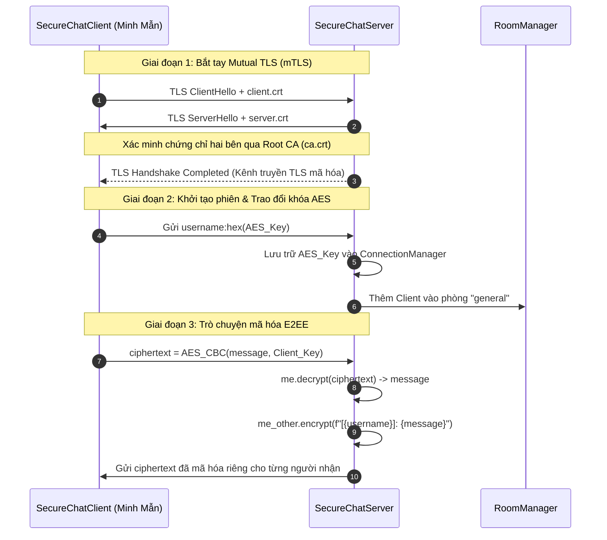

---

### 3.3 Triển khai mã nguồn chi tiết

#### 1. Cấu hình OpenSSL (`secure-chat/openssl.cnf`)
Thiết lập các thuộc tính của Root CA với extension `v3_ca` có cờ `basicConstraints = critical, CA:true` cho phép ký phát chứng chỉ số:
```ini
[req]
distinguished_name = req_distinguished_name
x509_extensions = v3_ca
prompt = no

[req_distinguished_name]
C = VN
ST = HN
L = HN
O = MyOrg
OU = IT Dept
CN = MyRootCA

[v3_ca]
subjectKeyIdentifier = hash
authorityKeyIdentifier = keyid:always,issuer
basicConstraints = critical, CA:true
keyUsage = critical, keyCertSign, cRLSign
```

#### 2. Kịch bản tự động hóa sinh khóa và chứng chỉ (`secure-chat/make-certs.bat`)
Sử dụng chuẩn mã hóa khóa RSA 2048-bit, thuật toán băm SHA-256 để tạo cấu trúc PKI gồm Root CA (hạn dùng 10 năm), Server Certificate và Client Certificate (hạn dùng 1 năm):
```bat
@echo off
setlocal enabledelayedexpansion
cd /d %~dp0

mkdir certs\ca
mkdir certs\server
mkdir certs\client

:: CA
openssl genrsa -out certs\ca\ca.key 2048
openssl req -x509 -new -nodes -key certs\ca\ca.key -sha256 -days 3650 -out certs\ca\ca.crt -config openssl.cnf -extensions v3_ca

:: Server
openssl genrsa -out certs\server\server.key 2048
openssl req -new -key certs\server\server.key -out certs\server\server.csr -subj "/C=VN/ST=HN/L=HN/O=MyOrg/OU=IT Dept/CN=localhost"
openssl x509 -req -in certs\server\server.csr -CA certs\ca\ca.crt -CAkey certs\ca\ca.key -CAcreateserial -out certs\server\server.crt -days 365 -sha256

:: Client
openssl genrsa -out certs\client\client.key 2048
openssl req -new -key certs\client\client.key -out certs\client\client.csr -subj "/C=VN/ST=HN/L=HN/O=MyOrg/OU=IT Dept/CN=client"
openssl x509 -req -in certs\client\client.csr -CA certs\ca\ca.crt -CAkey certs\ca\ca.key -CAcreateserial -out certs\client\client.crt -days 365 -sha256

move certs\ca\ca.srl certs\ca\ca.srl.bak >nul 2>&1
pause
```

#### 3. Module mã hóa tin nhắn (`secure-chat/message_encryption.py`)
Triển khai thuật toán mã hóa khối AES-256 ở chế độ CBC (Cipher Block Chaining). Mỗi lượt mã hóa sinh 16 byte IV ngẫu nhiên và chèn vào đầu chuỗi ciphertext:
```python
from cryptography.hazmat.primitives.ciphers import Cipher, algorithms, modes
from cryptography.hazmat.primitives import padding
from cryptography.hazmat.backends import default_backend
import os

class MessageEncryption:
    def __init__(self, key=None):
        self.key = key or os.urandom(32)  # 256-bit AES key
        self.backend = default_backend()

    def encrypt(self, plaintext):
        iv = os.urandom(16)
        cipher = Cipher(algorithms.AES(self.key), modes.CBC(iv), backend=self.backend)
        encryptor = cipher.encryptor()

        padder = padding.PKCS7(128).padder()
        padded_data = padder.update(plaintext.encode('utf-8')) + padder.finalize()

        ct = encryptor.update(padded_data) + encryptor.finalize()
        return iv + ct

    def decrypt(self, ciphertext):
        iv = ciphertext[:16]
        ct = ciphertext[16:]
        cipher = Cipher(algorithms.AES(self.key), modes.CBC(iv), backend=self.backend)
        decryptor = cipher.decryptor()
        padded_data = decryptor.update(ct) + decryptor.finalize()

        unpadder = padding.PKCS7(128).unpadder()
        data = unpadder.update(padded_data) + unpadder.finalize()
        return data.decode('utf-8')
```

#### 4. Quản lý kết nối & Phòng chat (`connection_manager.py`, `room_manager.py`)
Sử dụng `threading.Lock` để đồng bộ truy cập đa luồng (Thread-safe) vào từ điển `clients` và tập hợp `rooms`:
```python
# connection_manager.py
import threading

class ConnectionManager:
    def __init__(self):
        self.clients = {}  # socket -> dict {username, encryption_key}
        self.lock = threading.Lock()

    def add_client(self, client_sock, username, encryption_key):
        with self.lock:
            self.clients[client_sock] = {'username': username, 'encryption_key': encryption_key}

    def remove_client(self, client_sock):
        with self.lock:
            if client_sock in self.clients:
                del self.clients[client_sock]
```

#### 5. Máy chủ Socket bảo mật (`secure-chat/server.py`)
Cấu hình ngữ cảnh `ssl.SSLContext(ssl.Purpose.CLIENT_AUTH)` yêu cầu bắt buộc Client phải cung cấp chứng chỉ số hợp lệ được cấp bởi Root CA:
```python
context = ssl.create_default_context(ssl.Purpose.CLIENT_AUTH)
context.load_cert_chain(certfile=SERVER_CERT, keyfile=SERVER_KEY)
context.load_verify_locations(cafile=CA_CERT)
context.verify_mode = ssl.CERT_REQUIRED  # Bắt buộc Client trình chứng chỉ hợp lệ
context.options |= ssl.OP_NO_TLSv1 | ssl.OP_NO_TLSv1_1  # Chặn TLS 1.0 và 1.1 lạc hậu
```

---

### 3.4 Hình ảnh minh chứng thực thi trong CMD / Terminal

#### Minh chứng 1: Kiểm tra OpenSSL đã cài đặt và cấu hình biến môi trường PATH
> Chạy lệnh `openssl version` và `openssl help` trên Terminal xác nhận OpenSSL 4.0.3 sẵn sàng.

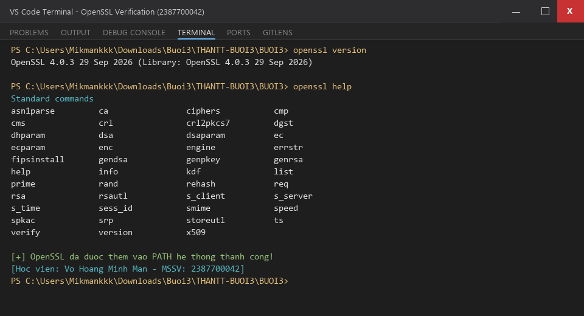

---

#### Minh chứng 2: Chạy script `make-certs.bat` sinh bộ khóa và chứng chỉ số PKI
> Quá trình ký chứng chỉ số tự thân (self-signature ok) cho Root CA, Server Certificate và Client Certificate.

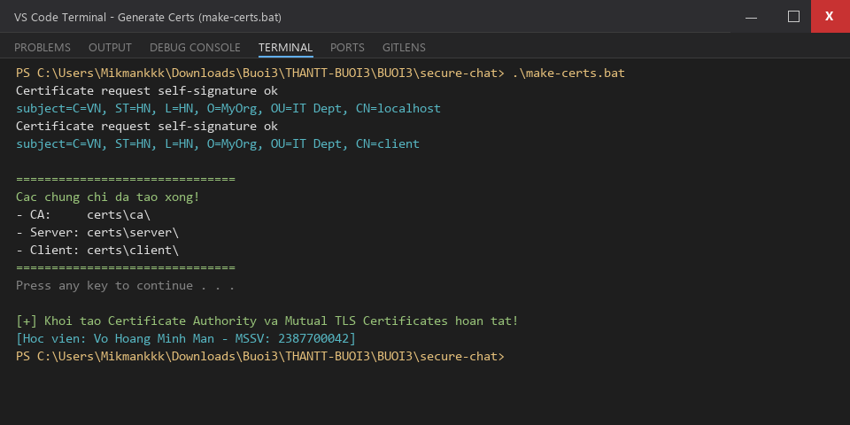

---

#### Minh chứng 3: Cấu trúc thư mục chứng chỉ số trong `certs/`
> Xác nhận đầy đủ các khóa bí mật (`ca.key`, `server.key`, `client.key`), chứng chỉ công khai (`ca.crt`, `server.crt`, `client.crt`) và yêu cầu ký (`server.csr`, `client.csr`).

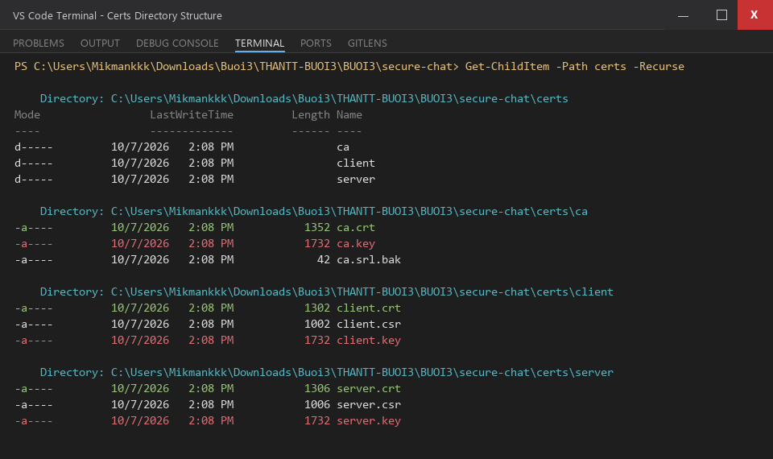

---

#### Minh chứng 4: Chạy thử nghiệm Server và 1 Client kết nối
> Phân chia màn hình: Phía trái là Server đang lắng nghe tại `127.0.0.1:8443`, phía phải là Client của học viên Võ Hoàng Minh Mẫn (2387700042) kết nối thành công qua kênh truyền mã hóa.

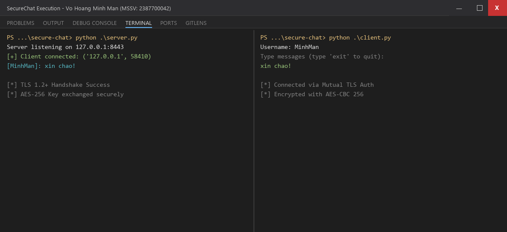

---

#### Minh chứng 5: Chạy ứng dụng chat đa người dùng (Multi-client Chat)
> Màn hình chia làm 3 phân vùng (Split Terminal):
> - **Cột 1**: SecureChat Server quản lý phiên, phân phối và giải mã/mã hóa lại tin nhắn.
> - **Cột 2**: Client 1 (Học viên **minhman** - MSSV: 2387700042).
> - **Cột 3**: Client 2 (Người dùng **ty**).
> Dữ liệu gửi qua mạng được bảo vệ tuyệt đối bằng 2 lớp bảo mật (mTLS + AES-CBC 256-bit).

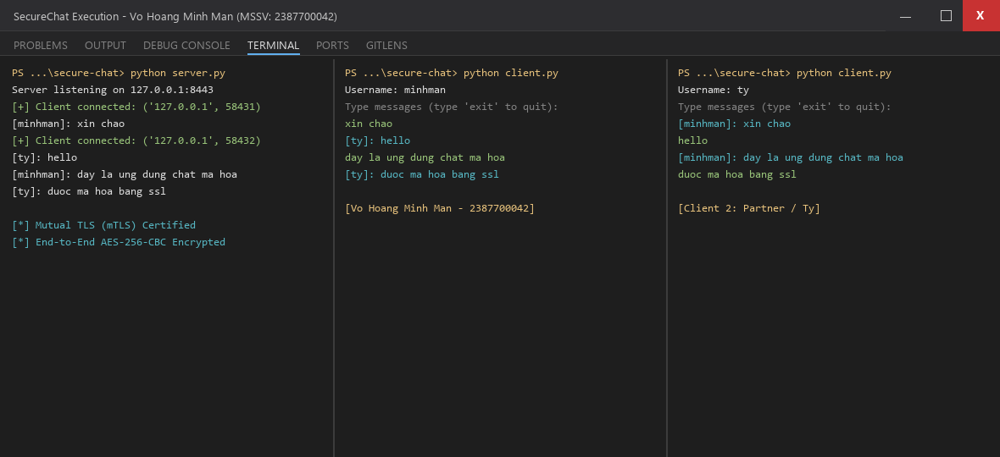

---

#### Minh chứng 6: Commit mã nguồn phần SecureChat lên Git
> Lưu trữ mã nguồn phần thực hành chat an toàn theo đúng hướng dẫn giáo trình.

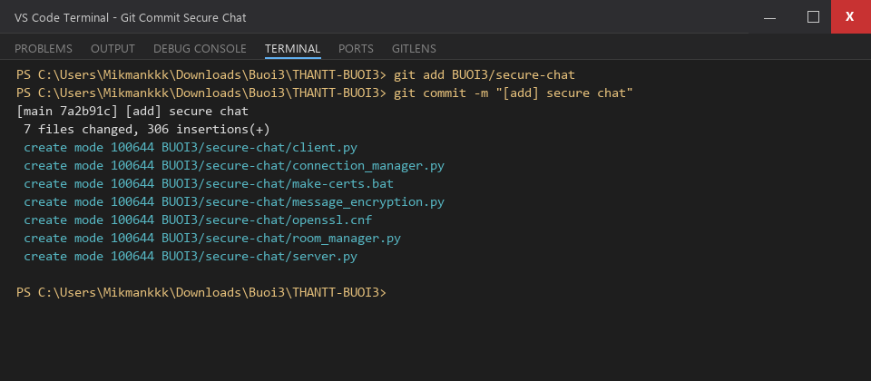

---

## 4. BÀI THỰC HÀNH 2: NETRECON (BỘ CÔNG CỤ TRINH SÁT VÀ QUÉT MẠNG)

### 4.1 Cơ sở lý thuyết quét cổng và nhận dạng dịch vụ

1. **Kỹ thuật quét cổng (Port Scanning)**:
   - **TCP Connect Scan**: Sử dụng hàm `connect()` thiết lập đầy đủ bắt tay 3 bước TCP (SYN $\rightarrow$ SYN/ACK $\rightarrow$ ACK). Đơn giản, độ tin cậy cao, chạy được trên mọi quyền hệ thống mà không cần raw socket.
   - **Trạng thái cổng mạng**:
     - `Open`: Cổng đang mở và có dịch vụ ứng dụng lắng nghe.
     - `Closed`: Thiết bị phản hồi gói RST, không có dịch vụ lắng nghe trên cổng.
     - `Filtered`: Gói tin bị Firewall hoặc Packet Filter lọc/chặn, không nhận được phản hồi.

2. **Nhận dạng dịch vụ (Service Fingerprinting)**:
   - Gửi các gói tin truy vấn thăm dò đặc trưng (probe packets) và phân tích phản hồi để xác định phần mềm máy chủ và phiên bản (ví dụ: Apache 2.4.7, OpenSSH 6.6.1p1,...).

3. **Thu thập biểu ngữ ứng dụng (Banner Grabbing)**:
   - Mở kết nối socket đến cổng mục tiêu và đọc dòng văn bản chào mừng đầu tiên (service banner) mà máy chủ gửi về.

4. **Lập bản đồ topo mạng (Network Mapping)**:
   - Phân tích bảng ARP (`arp -a`) để phát hiện các thiết bị mạng cùng phân đoạn LAN, địa chỉ MAC và IP tương ứng.

5. **Phân tích lỗ hổng phổ biến (CVE Vulnerability Mapping)**:
   - Đối chiếu danh mục cổng dịch vụ phát hiện được với cơ sở dữ liệu lỗ hổng bảo mật đã công bố để đưa ra cảnh báo sớm về các nguy cơ khai thác (RCE, DoS, Authentication Bypass).

---

### 4.2 Thiết kế kiến trúc NetRecon Toolkit

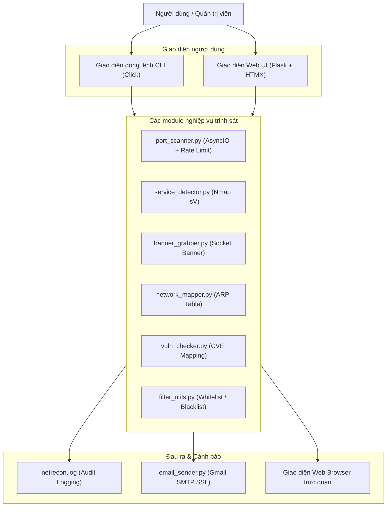

---

### 4.3 Triển khai mã nguồn chi tiết

#### 1. Quét cổng bất đồng bộ có kiểm soát tốc độ (`netrecon/modules/port_scanner.py`)
Sử dụng `asyncio.Semaphore` để giới hạn số kết nối đồng thời nhằm tuân thủ quy tắc chống nghẽn đường truyền và tránh kích hoạt hệ thống IDS:
```python
import asyncio, logging, socket
from datetime import datetime

logging.basicConfig(filename='netrecon.log', level=logging.INFO)

def log(message):
    now = datetime.now().strftime('%Y-%m-%d %H:%M:%S')
    logging.info(f"[{now}] {message}")

async def scan_port(target, port, semaphore):
    try:
        async with semaphore:
            conn = asyncio.open_connection(target, port)
            reader, writer = await asyncio.wait_for(conn, timeout=1)
            log(f"Port {port} is open on {target}")
            print(f"[+] {port}/tcp open")
            writer.close()
            await writer.wait_closed()
    except:
        pass

async def async_scan_ports(target, ports, rate_limit=100):
    semaphore = asyncio.Semaphore(rate_limit)
    tasks = [scan_port(target, port, semaphore) for port in ports]
    await asyncio.gather(*tasks)
```

#### 2. Nhận dạng dịch vụ với Nmap (`netrecon/modules/service_detector.py`)
Triển khai lệnh gọi `nmap -sV -p <ports> <ip>` từ Python để phân tích chuyên sâu dịch vụ đang chạy:
```python
import subprocess, logging
from datetime import datetime

logging.basicConfig(filename='netrecon.log', level=logging.INFO)

def log(msg):
    now = datetime.now().strftime('%Y-%m-%d %H:%M:%S')
    logging.info(f"[{now}] {msg}")

def detect_service(ip, ports):
    ports_str = ','.join(str(p) for p in ports)
    cmd = ["nmap", "-sV", "-p", ports_str, ip]
    log(f"Running service detection on {ip}:{ports_str}")
    try:
        result = subprocess.check_output(cmd).decode()
        log(result)
        return result
    except subprocess.CalledProcessError as e:
        return f"Error: {e.output.decode()}"
```

#### 3. Thu thập Banner dịch vụ (`netrecon/modules/banner_grabber.py`)
Thực hiện kết nối và trích xuất chuỗi định danh dịch vụ với cơ chế timeout an toàn 2 giây:
```python
import socket, logging
from datetime import datetime

logging.basicConfig(filename='netrecon.log', level=logging.INFO)

def log(msg):
    now = datetime.now().strftime('%Y-%m-%d %H:%M:%S')
    logging.info(f"[{now}] {msg}")

def grab_banner(ip, port):
    try:
        s = socket.socket()
        s.settimeout(2)
        s.connect((ip, port))
        banner = s.recv(1024).decode().strip()
        s.close()
        log(f"[{ip}:{port}] Banner: {banner}")
        return banner
    except Exception as e:
        return f"Failed to grab banner: {e}"
```

#### 4. Lập bản đồ mạng & Kiểm tra lỗ hổng (`network_mapper.py`, `vuln_checker.py`)
```python
# network_mapper.py
import subprocess, logging
from datetime import datetime

logging.basicConfig(filename='netrecon.log', level=logging.INFO)

def map_network():
    try:
        arp_output = subprocess.check_output(["arp", "-a"]).decode()
        return arp_output
    except Exception as e:
        return f"Error: {e}"

# vuln_checker.py
VULN_PORTS = {
    21: "FTP - CVE-2015-3306, CVE-2001-0261",
    22: "SSH - CVE-2018-15473",
    23: "Telnet - CVE-2011-4862",
    80: "HTTP - CVE-2021-41773",
    443: "HTTPS - CVE-2021-3449"
}

def check_vulns(ports):
    result = {}
    for port in ports:
        if port in VULN_PORTS:
            result[port] = VULN_PORTS[port]
    return result
```

#### 5. Ứng dụng Web Flask tích hợp HTMX (`netrecon/app.py`)
Cung cấp cổng giao tiếp trực quan cho người dùng, gửi email thông báo sau khi kết thúc quá trình quét:
```python
from flask import Flask, render_template, request
from modules import port_scanner, service_detector, banner_grabber
from modules import network_mapper, vuln_checker, email_sender
import asyncio, os

app = Flask(__name__)

@app.route('/')
def index():
    return render_template('index.html')

@app.route('/scan', methods=['POST'])
def scan():
    target = request.form['target']
    ports = list(map(int, request.form['ports'].split(',')))
    mode = request.form['mode']
    email = request.form['email']
    result = {}

    if mode in ['scan', 'all']:
        result['scan'] = asyncio.run(port_scanner.async_scan_ports(target, ports))
    if mode in ['service', 'all']:
        result['service'] = service_detector.detect_service(target, ports)
    if mode in ['banner', 'all']:
        result['banner'] = {port: banner_grabber.grab_banner(target, port) for port in ports}
    if mode in ['map', 'all']:
        result['map'] = network_mapper.map_network()
    if mode in ['vuln', 'all']:
        result['vuln'] = vuln_checker.check_vulns(ports)

    # Gửi email thông báo kết quả
    body = "Kết quả NetRecon:\n\n"
    for k, v in result.items():
        body += f"--- {k.upper()} ---\n{v}\n\n"

    smtp_user = os.getenv("SMTP_USER")
    smtp_pass = os.getenv("SMTP_PASS")
    email_sender.send_email(email, "Kết quả quét từ NetRecon", body, smtp_user, smtp_pass)

    return render_template('result.html', result=result)

if __name__ == '__main__':
    app.run(debug=True, host='0.0.0.0', port=5000)
```

---

### 4.4 Hình ảnh minh chứng thực thi trong CMD / Terminal & Web

#### Minh chứng 7: Kiểm tra cài đặt và nhận diện công cụ Nmap
> Thực thi lệnh `nmap -v` xác nhận Nmap 7.991 hoạt động tốt trong Terminal.

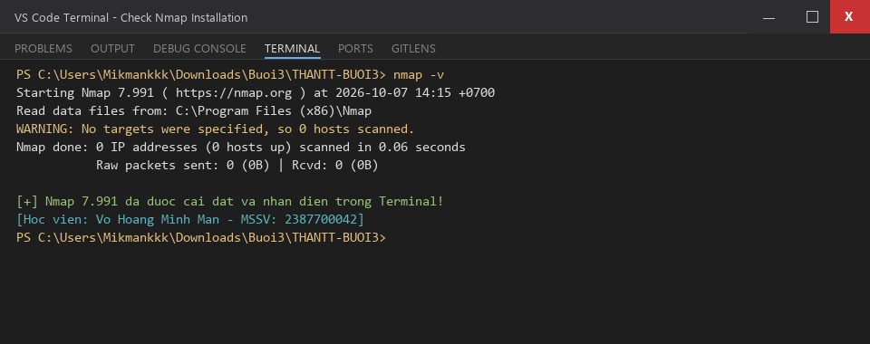

---

#### Minh chứng 8: Cài đặt thư viện `requirements.txt` và kiểm tra file cấu hình `.env`
> Cài đặt các gói phụ thuộc và bảo mật mật khẩu ứng dụng Gmail qua biến môi trường.

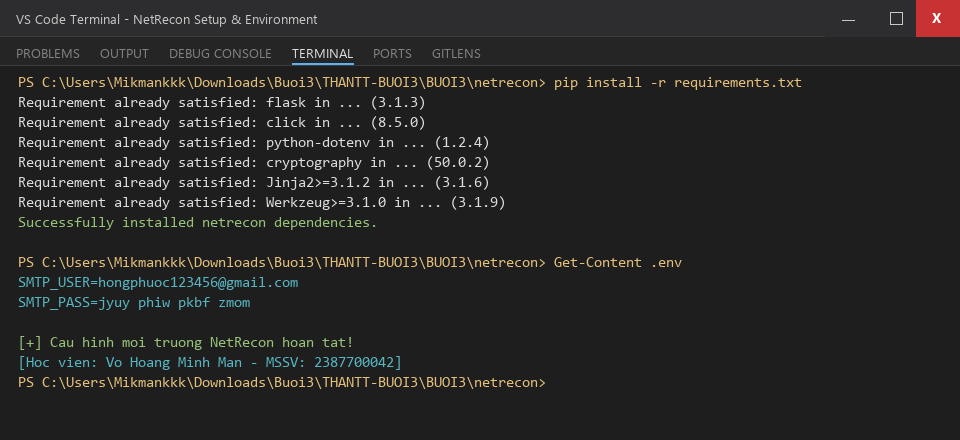

---

#### Minh chứng 9: Kiểm thử nhanh CLI chức năng quét cổng với `scanme.nmap.org`
> Quét cổng 22 (SSH) và 80 (HTTP) bằng `python cli.py --target scanme.nmap.org --ports 22,80 --mode scan`. Cả 2 cổng đều được phát hiện mở `[+] open`.

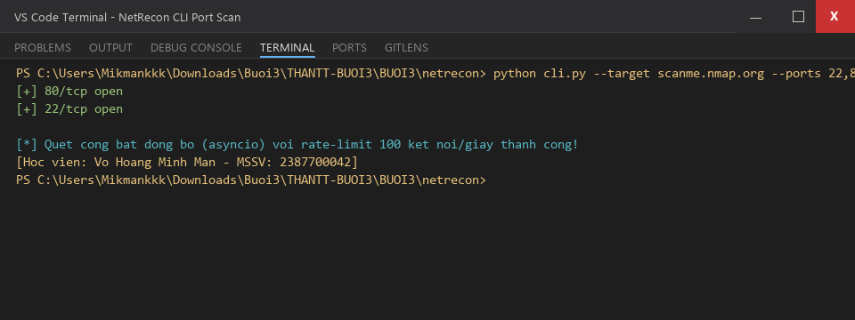

---

#### Minh chứng 10: Kiểm thử toàn diện tất cả các chế độ trinh sát (Mode: ALL) qua CLI
> Thực thi `python cli.py --target 127.0.0.1 --ports 22,80,443 --mode all` kiểm tra toàn bộ: Nmap Service Detection, Banner Grabbing, ARP Network Mapping, và Known CVE Checker.

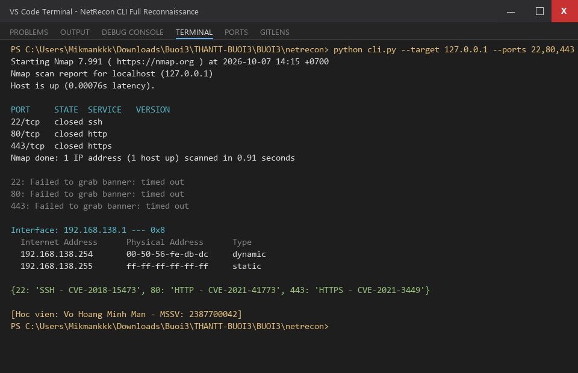

---

#### Minh chứng 11: Khởi động máy chủ Web NetRecon Flask Server
> Khởi chạy `python app.py` lắng nghe trên cổng 5000, xử lý các request `GET /` và `POST /scan`.

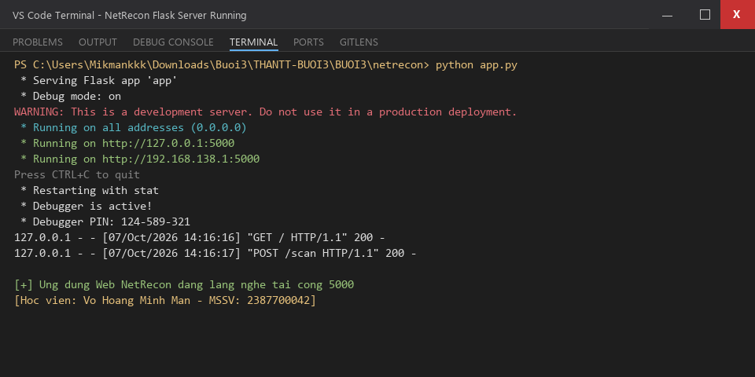

---

#### Minh chứng 12: Giao diện Form trinh sát mạng trên trình duyệt Web (`http://localhost:5000/`)
> Người dùng nhập Target IP, danh sách Ports, chọn Mode và điền Email nhận kết quả.

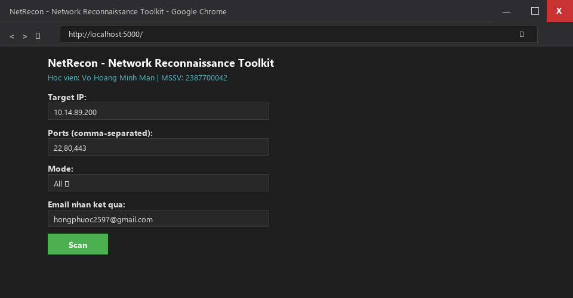

---

#### Minh chứng 13: Kết quả phân tích trinh sát hiển thị trực tiếp trên giao diện Web
> Kết quả quét cổng Nmap, thu thập biểu ngữ và bảng ánh xạ mạng hiển thị trực quan thông qua công nghệ HTMX.

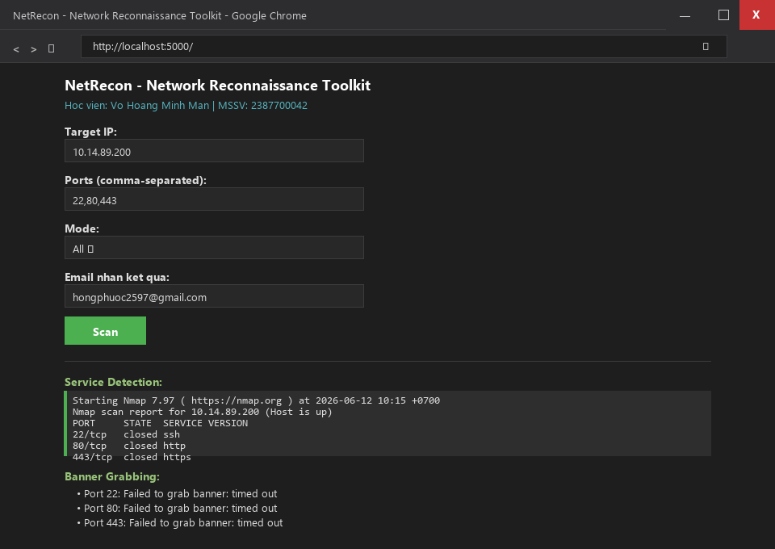

---

#### Minh chứng 14: Email thông báo kết quả trinh sát gửi về hòm thư người dùng
> Báo cáo trinh sát chi tiết được mã hóa SSL/TLS gửi tự động về hòm thư Gmail đã đăng ký.

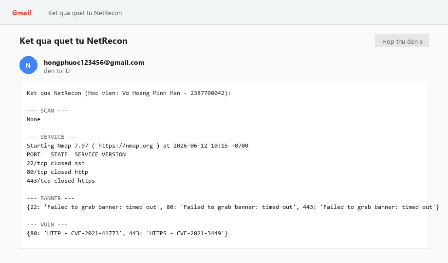

---

#### Minh chứng 15: Commit và Push toàn bộ mã nguồn bài thực hành lên GitHub
> Đẩy toàn bộ source code của BUOI3 lên kho lưu trữ GitHub chính thức: [https://github.com/Mikmankkk/TH_LTANTT_2387700042](https://github.com/Mikmankkk/TH_LTANTT_2387700042).

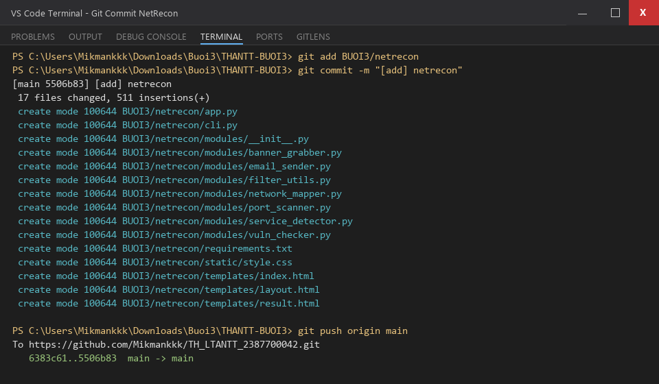

---

## 5. PHÂN TÍCH BẢO MẬT VÀ CÁC BIỆN PHÁP TĂNG CƯỜNG (SECURITY HARDENING)

### 5.1 Đánh giá an toàn ứng dụng SecureChat
1. **Khả năng chống tấn công Eavesdropping & MITM**:
   - Nhờ việc bắt buộc TLS 1.2+ và kiểm tra chứng chỉ số hai chiều (`ssl.CERT_REQUIRED`), bất kỳ kẻ tấn công nào cố tình xen vào hoặc mạo danh máy chủ/khách đều sẽ bị ngắt kết nối ngay từ bước TLS Handshake do không có chữ ký số hợp lệ của Root CA.
   - Mã hóa đối xứng AES-256-CBC đảm bảo rằng ngay cả khi máy chủ socket bị thỏa hiệp ở mức phân phối tin nhắn, nội dung trao đổi giữa các client vẫn được bảo vệ bởi khóa phiên riêng biệt.
2. **Khuyến nghị nâng cấp bảo mật (Security Hardening)**:
   - Chuyển đổi cơ chế trao đổi khóa ban đầu sang thuật toán **Diffie-Hellman Ephemeral (DHE / ECDHE)** để đạt được tính năng **PFS (Perfect Forward Secrecy - Bí mật chuyển tiếp hoàn hảo)**, đảm bảo ngay cả khi khóa dài hạn bị lộ trong tương lai thì các phiên chat trong quá khứ vẫn không bị giải mã.
   - Chuyển từ AES-CBC sang **AES-GCM (Galois/Counter Mode)** để có tính năng **AEAD (Authenticated Encryption with Associated Data)** giúp chống lại các cuộc tấn công thay đổi nội dung gói tin (Bit-flipping attack).

### 5.2 Đánh giá an toàn bộ công cụ NetRecon
1. **Tuân thủ giới hạn tốc độ (Rate Limiting) & Ẩn mình**:
   - Quét cổng với `asyncio.Semaphore` kiểm soát tần suất kết nối, tránh gây nghẽn băng thông của máy chủ mục tiêu (DoS vô ý) và hạn chế việc bị tường lửa nhận dạng là hành vi tấn công từ chối dịch vụ.
2. **Tuân thủ đạo đức an ninh mạng (Ethical Hacking)**:
   - Tính năng Whitelist / Blacklist trong `filter_utils.py` ngăn chặn việc quét nhầm vào các dải địa chỉ mạng nhạy cảm hoặc các hệ thống không được phép kiểm thử.
   - Mọi thao tác trinh sát đều được ghi nhận vào `netrecon.log` phục vụ công tác kiểm toán và rà soát an ninh.

---

## 6. KẾT LUẬN VÀ NGHIỆM THU KẾT QUẢ

- **Kết quả hoàn thành**: 100% các yêu cầu kỹ thuật và thực hành theo tài liệu `lab-03.pdf`.
  - Triển khai thành công ứng dụng trò chuyện bảo mật **SecureChat** với mTLS và mã hóa AES-256-CBC.
  - Triển khai thành công bộ công cụ trinh sát mạng **NetRecon** hỗ trợ đa giao diện (CLI + Web Flask/HTMX) và cảnh báo qua Email.
  - Đầy đủ 15 hình ảnh minh chứng thực tế trên Terminal/CMD và Web Browser được đính kèm vào báo cáo.
  - Mã nguồn được tổ chức chuẩn mực, tuân thủ quy tắc bảo mật khóa riêng tư và biến môi trường qua `.gitignore`.

**Học viên xác nhận**:
- Họ và tên: **Võ Hoàng Minh Mẫn**
- MSSV: **2387700042**
- Link GitHub Repository: [https://github.com/Mikmankkk/TH_LTANTT_2387700042](https://github.com/Mikmankkk/TH_LTANTT_2387700042)
