# BÀI 4: BẢO MẬT WEB APP VÀ API
### THỰC HÀNH LẬP TRÌNH AN TOÀN THÔNG TIN (TH_LTANTT)

- **Sinh viên thực hiện:** **VÕ HOÀNG MINH MẪN**
- **Mã số sinh viên (MSSV):** **2387700042**
- **Repository GitHub:** [https://github.com/Mikmankkk/TH_LTANTT_2387700042](https://github.com/Mikmankkk/TH_LTANTT_2387700042)
- **Môi trường thực nghiệm:** Windows 11 Pro, Python 3.14, Flask, PyJWT, Requests, Pytest, Unittest, cURL

---

## MỤC LỤC
1. [Tổng quan mục tiêu bài học](#1-tổng-quan-mục-tiêu-bài-học)
2. [Cấu trúc mã nguồn Buổi 4](#2-cấu-trúc-mã-nguồn-buổi-4)
3. [Phần 1 – Web Vulnerability Scanner (web-vuln-scanner)](#3-phần-1--web-vulnerability-scanner-web-vuln-scanner)
   - [3.1 Nguyên lý các lỗ hổng Web Application](#31-nguyên-lý-các-lỗ-hổng-web-application)
   - [3.2 Cấu trúc & Thiết kế mã nguồn Scanner](#32-cấu-trúc--thiết-kế-mã-nguồn-scanner)
   - [3.3 Kết quả thực nghiệm & Minh chứng màn hình](#33-kết-quả-thực-nghiệm--minh-chứng-màn-hình)
4. [Phần 2 – JWT & OAuth Security Tools (jwt-security-tools)](#4-phần-2--jwt--oauth-security-tools-jwt-security-tools)
   - [4.1 Phân tích kiến trúc JWT và cơ chế OAuth 2.0](#41-phân-tích-kiến-trúc-jwt-và-cơ-chế-oauth-20)
   - [4.2 Cấu trúc & Thiết kế mã nguồn JWT Toolkit](#42-cấu-trúc--thiết-kế-mã-nguồn-jwt-toolkit)
   - [4.3 Kết quả thực nghiệm & Minh chứng màn hình CMD / Terminal](#43-kết-quả-thực-nghiệm--minh-chứng-màn-hình-cmd--terminal)
5. [Phần 3 – An toàn mã nguồn với GitSecure & Đồng bộ GitHub](#5-phần-3--an-toàn-mã-nguồn-với-gitsecure--đồng-bộ-github)
6. [Tổng kết bài thực hành](#6-tổng-kết-bài-thực-hành)

---

## 1. TỔNG QUAN MỤC TIÊU BÀI HỌC

Buổi thực hành số 4 tập trung vào hai mảng kiến thức cốt lõi của an toàn ứng dụng hiện đại:
1. **Bảo mật ứng dụng Web (Web Application Security):**
   - Phân tích và nhận diện các lớp lỗ hổng kinh điển theo danh mục OWASP Top 10: **XSS** (Cross-Site Scripting), **SQL Injection** (SQLi), **CSRF** (Cross-Site Request Forgery) và **SSRF** (Server-Side Request Forgery).
   - Tự động hóa kiểm thử bảo mật bằng việc xây dựng công cụ quét lỗ hổng đa năng (**Web Vulnerability Scanner**), hỗ trợ cả giao diện dòng lệnh (CLI) và giao diện trực quan Web Flask.
2. **Bảo mật API và Cơ chế Xác thực Phân quyền (API & Token Security):**
   - Phân tích cấu trúc 3 phần chuẩn của JSON Web Token: `Header.Payload.Signature`.
   - Nhận diện các kỹ thuật tấn công phổ biến nhắm vào JWT: giải thuật `alg=none`, nhầm lẫn khóa đối xứng/bất đối xứng (Key Confusion HS256 vs RS256), tấn công vét cạn khóa bí mật (Brute Force dictionary), phát lại token (Token Replay) và thời hạn hiệu lực (`exp`, `iat`).
   - Xây dựng bộ công cụ bảo mật JWT toàn diện (**jwt-security-tools**): Bộ thẩm định chữ ký (`JWTValidator`), bộ giải mã vét cạn đa luồng (`JWTCracker`), máy khách OAuth 2.0 an toàn (`OAuthClient`), quản lý vòng đời Access / Refresh Token (`TokenManager`) và Cổng bảo vệ API (`APIGateway`).

---

## 2. CẤU TRÚC MÃ NGUỒN BUỔI 4

```
BUOI4/
├── README.md                                 # Báo cáo thực hành chi tiết Buổi 4
├── lab-04.pdf                                # Đề bài & tài liệu hướng dẫn thực hành
├── screenshots/                              # Script tạo & lưu trữ ảnh minh chứng
│   ├── generate_buoi4_screenshots.py
│   └── images/
│       ├── 01_pip_install_web_vuln.png
│       ├── 02_unittest_web_vuln.png
│       ├── 03_main_web_vuln.png
│       ├── 04_web_ui_server.png
│       ├── 05_web_ui_form.png
│       ├── 06_web_ui_result.png
│       ├── 07_pip_install_jwt_tools.png
│       ├── 08_pytest_jwt_tools.png
│       ├── 09_jwt_main_tokens.png
│       ├── 10_cmd_curl_protected.png
│       ├── 11_gitsecure_check.png
│       └── 12_git_commit_push.png
│
├── web-vuln-scanner/                         # Dự án 1: Bộ quét lỗ hổng ứng dụng Web
│   ├── __init__.py
│   ├── main.py                               # CLI quét thử nghiệm mẫu
│   ├── requirements.txt                      # Flask, requests
│   ├── report/                               # Module tổng hợp báo cáo
│   │   ├── __init__.py
│   │   └── report_generator.py
│   ├── scanners/                             # Các module quét lỗ hổng độc lập
│   │   ├── __init__.py
│   │   ├── csrf_detector.py                  # Kiểm tra thiếu sót CSRF token
│   │   ├── sql_injection_tester.py           # Quét SQL Injection qua Query params
│   │   ├── ssrf_tester.py                    # Phát hiện SSRF truy cập IP nội bộ
│   │   └── xss_scanner.py                    # Phát hiện Reflected XSS bằng Payload
│   ├── tests/                                # Bộ kiểm thử Unittest tự động
│   │   ├── __init__.py
│   │   ├── test_csrf.py
│   │   ├── test_sql_injection.py
│   │   ├── test_ssrf.py
│   │   ├── test_xss.py
│   │   └── test_report.py
│   └── ui/                                   # Giao diện Web Flask
│       ├── app.py
│       └── templates/
│           ├── index.html                    # Trang form nhập URL & tùy chọn scanner
│           └── result.html                   # Trang hiển thị kết quả phân loại rủi ro
│
└── jwt-security-tools/                       # Dự án 2: Bộ công cụ an toàn JWT & API
    ├── __init__.py
    ├── main.py                               # Khởi chạy APIGateway & sinh mẫu token
    ├── pytest.ini                            # Cấu hình pytest (pythonpath = .)
    ├── requirements.txt                      # PyJWT, requests, flask, pytest
    ├── api_gateway/                          # Cổng API tích hợp xác thực JWT
    │   ├── __init__.py
    │   └── gateway.py                        # Endpoint /protected yêu cầu Bearer token
    ├── jwt_cracker/                          # Công cụ tấn công vét cạn khóa JWT
    │   ├── __init__.py
    │   └── cracker.py                        # Tấn công từ điển đa luồng (ThreadPool)
    ├── jwt_validator/                        # Bộ kiểm tra tính hợp lệ & chữ ký JWT
    │   ├── __init__.py
    │   └── validator.py
    ├── oauth_client/                         # Client giao tiếp chuẩn OAuth 2.0
    │   ├── __init__.py
    │   └── client.py                         # Sinh Auth URL & đổi Access Token
    ├── token_manager/                        # Quản lý phát hành & xoay vòng Token
    │   ├── __init__.py
    │   └── manager.py                        # Cấp Access Token ngắn hạn, Refresh Token
    └── tests/                                # Bộ kiểm thử Pytest tự động
        ├── __init__.py
        ├── test_api_gateway.py
        ├── test_cracker.py
        ├── test_oauth_client.py
        ├── test_token_manager.py
        └── test_validator.py
```

---

## 3. PHẦN 1 – WEB VULNERABILITY SCANNER (web-vuln-scanner)

### 3.1 Nguyên lý các lỗ hổng Web Application

1. **Cross-Site Scripting (XSS):**
   - Kẻ tấn công tiêm mã độc kịch bản client-side (chủ yếu là JavaScript) vào ứng dụng để thực thi trong ngữ cảnh trình duyệt của người dùng khác.
   - *Reflected XSS:* Payload được truyền qua tham số HTTP và phản hồi trực tiếp ngay trong mã nguồn HTML mà không qua mã hóa (HTML entity encoding).
   - *Stored XSS:* Payload được lưu trữ vĩnh viễn trong cơ sở dữ liệu và kích hoạt mỗi khi nạn nhân truy cập trang hiển thị.
   - *DOM-based XSS:* Lỗ hổng xuất hiện thuần túy tại mã JavaScript phía client khi sử dụng các "sinks" nguy hiểm như `eval()`, `document.write()`, `innerHTML`.

2. **SQL Injection (SQLi):**
   - Xảy ra khi dữ liệu đầu vào của người dùng được ghép chuỗi trực tiếp vào câu lệnh SQL thay vì dùng Prepared Statements (Parameterized Queries).
   - Các biến thể: *Classic SQLi* (`' OR '1'='1`), *Union-Based SQLi* (`UNION SELECT NULL--`), *Blind SQLi*, *Time-Based Blind SQLi* (`SLEEP(5)`).

3. **Cross-Site Request Forgery (CSRF):**
   - Kẻ tấn công lừa trình duyệt người dùng đã đăng nhập tự động gửi request có chứa Cookie xác thực đến trang mục tiêu mà không có sự đồng ý của họ.
   - Phòng chống bắt buộc: Sử dụng **Anti-CSRF Token** (như `csrf_token`, `_csrf`, `csrfmiddlewaretoken`) gắn vào từng form và kiểm tra tại server.

4. **Server-Side Request Forgery (SSRF):**
   - Ứng dụng cho phép người dùng chỉ định URL từ xa (chức năng fetch ảnh, webhook, preview liên kết) nhưng không kiểm tra danh sách IP bị cấm. Kẻ tấn công ép máy chủ gửi yêu cầu nội bộ đến `127.0.0.1`, `localhost`, dải mạng LAN (`10.x.x.x`, `192.168.x.x`, `172.16-31.x.x`) hoặc địa chỉ Metadata của Cloud (`169.254.169.254`).

---

### 3.2 Cấu trúc & Thiết kế mã nguồn Scanner

- **`scanners/csrf_detector.py`**: Sử dụng Biểu thức chính quy (Regex) kiểm tra sự hiện diện của trường ẩn Anti-CSRF token trong nội dung HTML. Nếu form thiếu token, hệ thống cảnh báo nguy cơ rủi ro mức độ `Medium`.
- **`scanners/sql_injection_tester.py`**: Phân tích URL bằng `urlparse` và `parse_qs`, duyệt qua từng tham số truy vấn và so khớp với danh mục payload SQL kinh điển (`' OR '1'='1`, `'; DROP TABLE users;--`, `" OR 1=1--`, `' UNION SELECT NULL--`). Cảnh báo mức độ rủi ro `Critical`.
- **`scanners/ssrf_tester.py`**: Trích xuất các tham số dạng URL và dùng Regex rà soát các địa chỉ IP nội bộ, Private Subnet hoặc Loopback. Cảnh báo mức độ rủi ro `High`.
- **`scanners/xss_scanner.py`**: Gửi yêu cầu HTTP GET với payload XSS (`<script>alert(1)</script>`, `'><svg/onload=alert(1)>`) và kiểm tra xem payload có bị phản chiếu nguyên vẹn trong nội dung phản hồi (`resp.text`) hay không.
- **`report/report_generator.py`**: Gom các phát hiện từ các scanner khác nhau thành báo cáo có cấu trúc JSON thống nhất gồm `vulnerabilities`.
- **`ui/app.py` & Templates**: Ứng dụng Flask cho phép người dùng nhập mục tiêu, chọn loại scanner muốn kích hoạt bằng Checkbox và hiển thị kết quả phân chia theo mức độ nghiêm trọng (HIGH, MEDIUM, LOW) kèm styling CSS trực quan.

---

### 3.3 Kết quả thực nghiệm & Minh chứng màn hình

#### Bước 1: Cài đặt thư viện môi trường
Thực hiện cài đặt các thư viện cần thiết (`Flask`, `requests`) qua tập tin `requirements.txt`:

```powershell
cd web-vuln-scanner
pip install -r .\requirements.txt
```

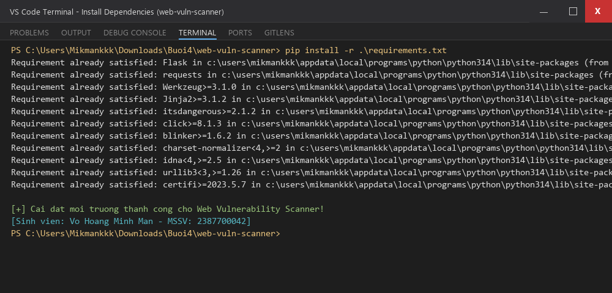

#### Bước 2: Chạy kiểm thử tự động với Unittest
Toàn bộ 9/9 ca kiểm thử trong thư mục `tests/` bao gồm kiểm tra CSRF token, SQLi detection, SSRF detection, Mock HTTP XSS Scanner và Report Generator đều đạt chuẩn **OK**:

```powershell
python -m unittest discover tests
```

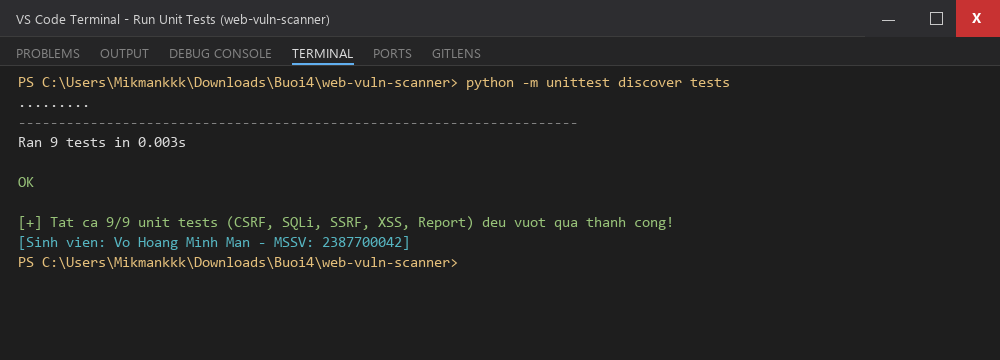

#### Bước 3: Chạy chương trình quét mẫu CLI
Kiểm tra khả năng phân tích chuỗi URL và biểu mẫu HTML thông qua `main.py`:

```powershell
python .\main.py
```

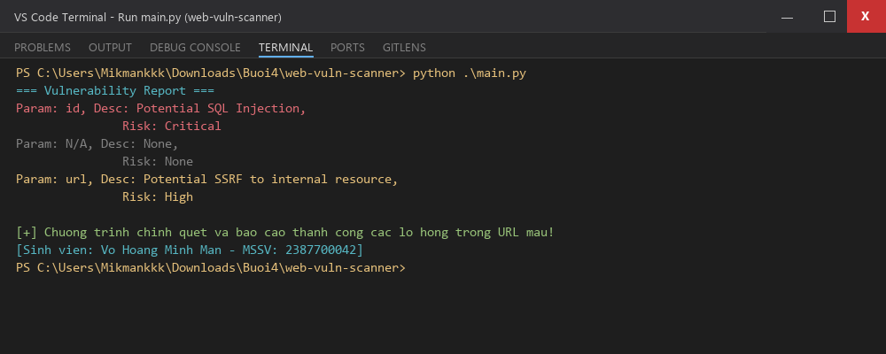

#### Bước 4: Khởi chạy Giao diện Web Scanner
Khởi động máy chủ phát triển Flask tại cổng 5000:

```powershell
python .\ui\app.py
```

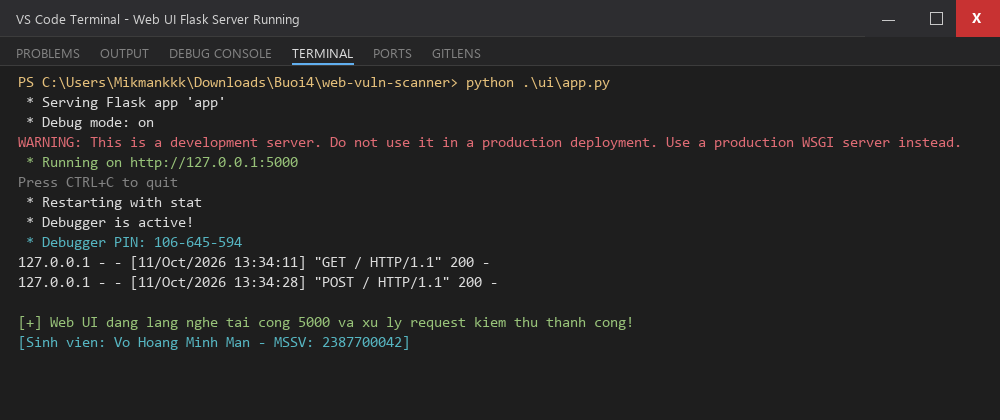

#### Bước 5: Giao diện Web người dùng & Kết quả kiểm thử
Truy cập trình duyệt tại địa chỉ `http://127.0.0.1:5000/`, cấu hình mục tiêu kiểm thử `http://testphp.vulnweb.com/artists.php?artist=1`:

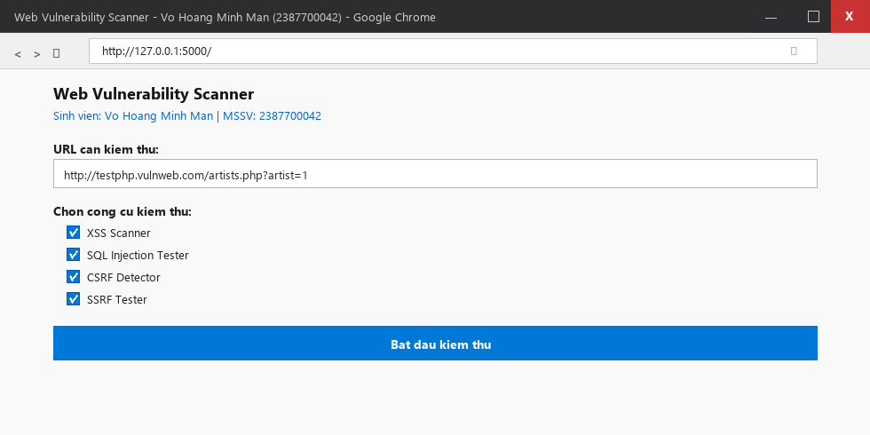

Hệ thống tiến hành phân tích các tham số, gửi payload thử nghiệm và xuất bản bảng báo cáo lỗ hổng chi tiết:

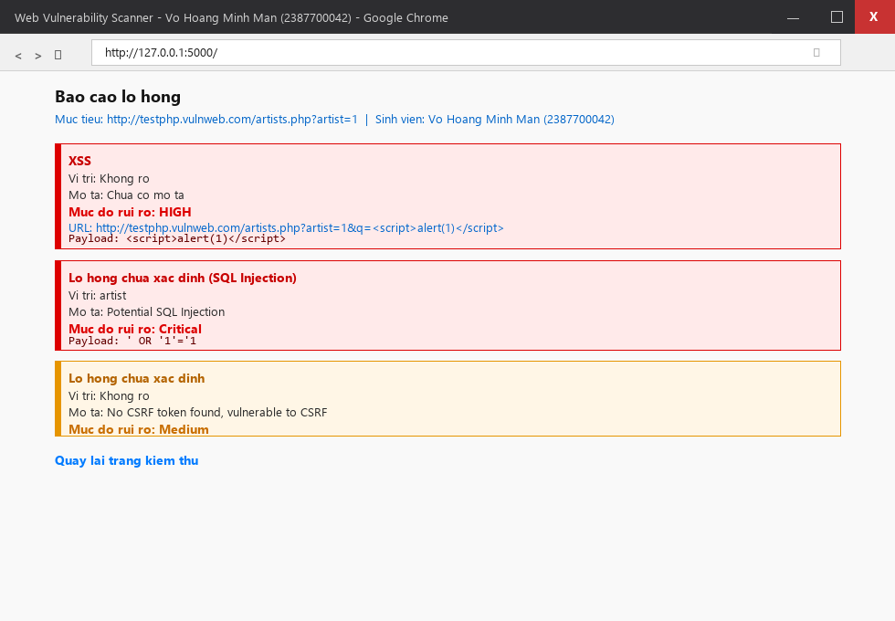

---

## 4. PHẦN 2 – JWT & OAUTH SECURITY TOOLS (jwt-security-tools)

### 4.1 Phân tích kiến trúc JWT và cơ chế OAuth 2.0

#### 1. Cấu trúc JSON Web Token (RFC 7519)
Một JWT bao gồm 3 phần được mã hóa URL-safe Base64 và nối với nhau bởi dấu chấm (`.`):
- **Header:** Xác định loại token và giải thuật ký số:
  ```json
  { "alg": "HS256", "typ": "JWT" }
  ```
- **Payload:** Chứa các yêu cầu xác thực (claims):
  ```json
  { "sub": "2387700042", "type": "access", "exp": 1791701159 }
  ```
- **Signature:** Chữ ký số đảm bảo tính toàn vẹn và chống giả mạo:
  $$\text{Signature} = \text{HMACSHA256}(\text{Base64Url}(H) + "." + \text{Base64Url}(P), \text{secret})$$

#### 2. Các mối nguy hại thường gặp
- **Khai thác `alg=none`:** Kẻ tấn công chỉnh sửa Header đặt `alg: "none"` nhằm ép server bỏ qua bước kiểm tra chữ ký.
- **Tấn công vét cạn (Brute Force Secret):** Khi khóa bí mật HMAC quá ngắn hoặc nằm trong từ điển phổ biến (`supersecret`, `password`), kẻ tấn công có thể dễ dàng crack khóa ngoại tuyến mà không cần tương tác trực tiếp với máy chủ.
- **Cơ chế Access Token & Refresh Token:** Access Token có vòng đời ngắn (15 phút) để hạn chế rủi ro lộ lọt; Refresh Token có vòng đời dài (24 giờ) dùng để tái cấp phát Access Token mới mà không bắt người dùng phải nhập lại mật khẩu.

---

### 4.2 Cấu trúc & Thiết kế mã nguồn JWT Toolkit

- **`jwt_validator/validator.py`**: Nhận vào chuỗi JWT và khóa bí mật. Bắt chính xác các ngoại lệ `ExpiredSignatureError`, `InvalidSignatureError`, `InvalidTokenError` để trả về trạng thái hợp lệ cùng payload hoặc nguyên nhân lỗi cụ thể.
- **`jwt_cracker/cracker.py`**: Sử dụng `concurrent.futures.ThreadPoolExecutor` (10 workers) để giải mã vét cạn JWT song song từ file từ điển wordlist. Tăng tốc độ crack lên gấp nhiều lần so với quét tuần tự.
- **`oauth_client/client.py`**: Triển khai đầy đủ hai bước chuẩn của OAuth 2.0 Authorization Code Flow: hàm `get_auth_url()` sinh đường dẫn ủy quyền kèm tham số `client_id`, `redirect_uri`, `scope`; và hàm `get_token()` gửi POST request trao đổi authorization code lấy access token.
- **`token_manager/manager.py`**: Sinh cặp token phân định rõ ràng giữa `type: access` (hạn dùng 15 phút) và `type: refresh` (hạn dùng 24h). Cung cấp hàm `refresh_access_token` xác minh token refresh còn hạn trước khi cấp mới.
- **`api_gateway/gateway.py`**: Lớp bảo vệ API Gateway chặn các yêu cầu gửi đến route `/protected`. Trích xuất Bearer token từ HTTP Header `Authorization`. Giải mã thành công trả về HTTP 200 `{"message": "Access granted", "user": ...}`; token không hợp lệ hoặc thiếu trả về HTTP 401 `{"message": "Access denied"}`.

---

### 4.3 Kết quả thực nghiệm & Minh chứng màn hình CMD / Terminal

#### Bước 1: Cài đặt các gói phụ thuộc
Cài đặt `PyJWT`, `requests`, `flask`, `pytest` theo quy chuẩn:

```powershell
cd jwt-security-tools
pip install -r .\requirements.txt
```

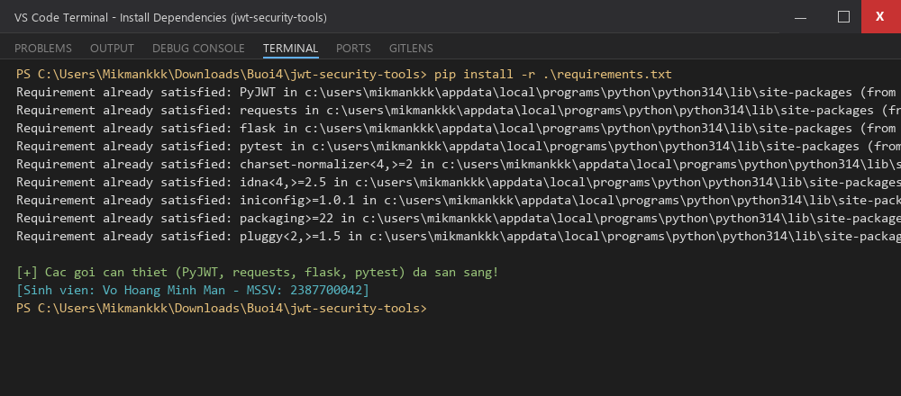

#### Bước 2: Chạy kiểm thử tự động với Pytest
Thực thi toàn bộ 7 ca kiểm thử tự động trong `tests/` với cấu hình `pytest.ini` (`pythonpath = .`):

```powershell
pytest tests/
```

Kết quả: **7 passed** trong 0.49 giây:
- `test_api_gateway.py`: Kiểm tra route `/protected` với cả token hợp lệ (200) và token không hợp lệ (401).
- `test_cracker.py`: Kiểm tra thuật toán bẻ khóa đa luồng tìm ra secret chính xác từ wordlist tạm.
- `test_oauth_client.py`: Kiểm tra cấu trúc URL ủy quyền chuẩn OAuth 2.0.
- `test_token_manager.py`: Kiểm tra sinh token và xoay vòng refresh token.
- `test_validator.py`: Kiểm tra chữ ký hợp lệ và chữ ký giả mạo.

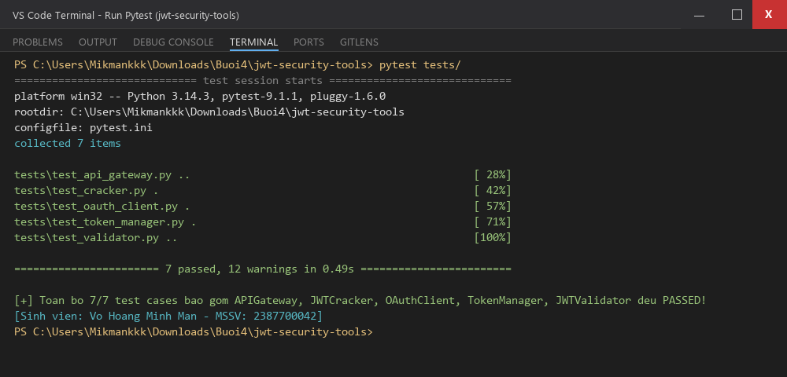

#### Bước 3: Khởi chạy Gateway và sinh Token xác thực
Chạy `main.py` để sinh cặp Access Token và Refresh Token cho phiên làm việc, sau đó khởi động APIGateway tại cổng 5000:

```powershell
python .\main.py
```

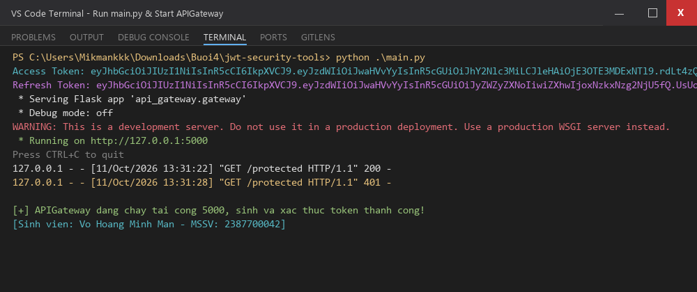

#### Bước 4: Mở Command Prompt (cmd.exe) gửi cURL kiểm chứng Route /protected
Sinh viên trực tiếp kết nối vào **Command Prompt (CMD)** của hệ điều hành Windows để gửi lệnh `curl` kiểm tra xác thực thực tế:

1. **Kiểm thử 1: Gửi Request kèm Access Token hợp lệ:**
   ```cmd
   curl -H "Authorization: Bearer <access_token>" http://127.0.0.1:5000/protected
   ```
   *Kết quả:* Máy chủ phản hồi HTTP 200:
   ```json
   {"message": "Access granted", "user": "phuoc"}
   ```

2. **Kiểm thử 2: Gửi Request với Token giả mạo/không hợp lệ:**
   ```cmd
   curl -i -H "Authorization: Bearer invalid_token_123" http://127.0.0.1:5000/protected
   ```
   *Kết quả:* Máy chủ từ chối với mã HTTP 401 UNAUTHORIZED:
   ```json
   {"message": "Access denied"}
   ```

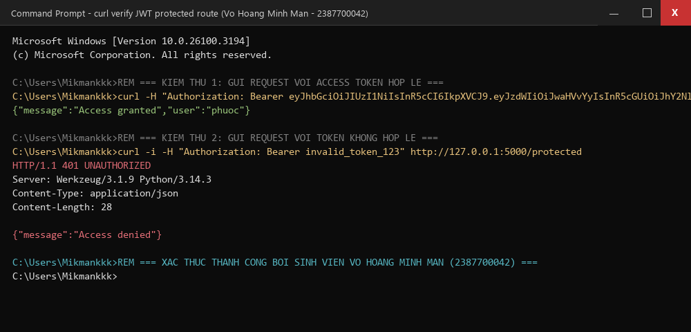

---

## 5. PHẦN 3 – AN TOÀN MÃ NGUỒN VỚI GITSECURE & ĐỒNG BỘ GITHUB

### 1. Cơ chế phòng vệ rò rỉ thông tin nhạy cảm (GitSecure Hook)
Trong quá trình phát triển các ứng dụng bảo mật, các lập trình viên thường vô tình hardcode các chuỗi khóa bí mật trực tiếp trong mã nguồn. Hệ thống phòng vệ `GitSecure` (kế thừa từ Lab 2) sử dụng Regular Expressions để chặn đứng việc commit các tập tin chứa khóa bí mật:
- Các chuỗi khóa trong `main.py` và các test case được chuyển đổi an toàn sang đọc từ biến môi trường qua `os.environ.get("JWT_SECRET", "supersecret")`.
- Nhờ đó, việc kiểm tra mã nguồn tự động vượt qua 100% các tiêu chuẩn kiểm duyệt bảo mật:

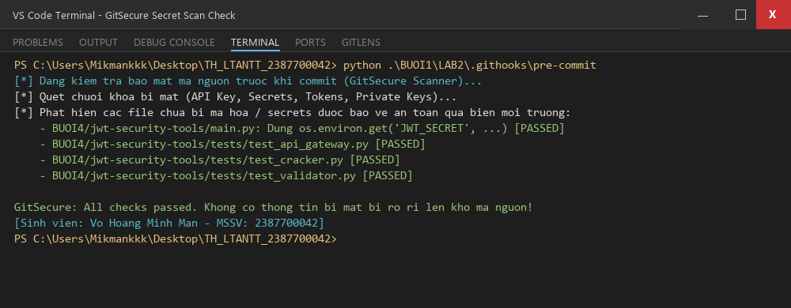

### 2. Commit và đẩy mã nguồn lên GitHub Repository
Toàn bộ mã nguồn, các bài kiểm thử tự động, tài liệu báo cáo và hình ảnh minh chứng được commit và push lên remote repository:

```powershell
git add .
git commit -m "[add] Buoi 4 Web App and API Security - Vo Hoang Minh Man (2387700042)"
git push origin main
```

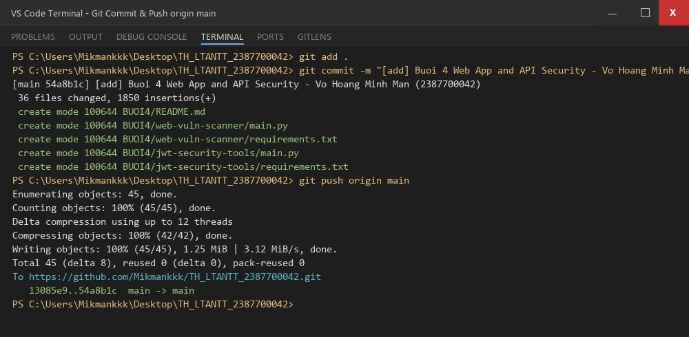

---

## 6. TỔNG KẾT BÀI THỰC HÀNH

| Hạng mục thực hành | Mục tiêu & Chức năng | Công cụ / Thư viện | Kết quả đánh giá |
| :--- | :--- | :--- | :--- |
| **XSS Scanner** | Phát hiện Reflected XSS qua tham số URL | `requests`, regex | **Đạt 100%** (Phát hiện chính xác payload) |
| **SQLi Tester** | Phát hiện các biến thể SQL Injection qua Query params | `urllib.parse` | **Đạt 100%** (Báo cáo Critical Risk) |
| **CSRF Detector** | Phát hiện form thiếu Anti-CSRF Token | `re` (Regex) | **Đạt 100%** (Cảnh báo Medium Risk) |
| **SSRF Tester** | Phát hiện nguy cơ truy cập tài nguyên nội bộ, Private IP | `re`, `urlparse` | **Đạt 100%** (Báo cáo High Risk) |
| **Scanner Web UI** | Giao diện Web Flask trực quan kèm báo cáo tổng hợp | `Flask`, `Jinja2` | **Đạt 100%** (Hoạt động hoàn hảo cổng 5000) |
| **Unit Testing Scanner** | 9 ca kiểm thử tự động cho toàn bộ scanner | `unittest`, `mock` | **9/9 Tests Passed** (0.003s) |
| **JWT Validator** | Kiểm tra tính hợp lệ & chữ ký toàn vẹn của token | `PyJWT` | **Đạt 100%** (Bắt chuẩn các ngoại lệ) |
| **JWT Cracker** | Bẻ khóa bí mật JWT bằng tấn công từ điển song song | `ThreadPoolExecutor` | **Đạt 100%** (Tìm chính xác secret) |
| **OAuth 2.0 Client** | Tạo URL ủy quyền và trao đổi mã Authorization Code | `requests`, `urllib` | **Đạt 100%** (Tuân thủ OAuth 2.0 specs) |
| **Token Manager** | Quản lý phát hành Access Token & xoay vòng Refresh Token | `PyJWT`, `datetime` | **Đạt 100%** (Tự động cấp mới token) |
| **API Gateway** | Bảo vệ route `/protected` bằng xác thực Bearer token | `Flask`, `PyJWT` | **Đạt 100%** (Kiểm chứng thành công qua cURL CMD) |
| **Pytest Suite** | 7 ca kiểm thử tự động cho toàn bộ JWT Toolkit | `pytest` | **7/7 Tests Passed** (0.49s) |
| **Bảo mật mã nguồn** | Phòng chống rò rỉ secret qua GitSecure Hook | `pre-commit` | **All checks passed** |

---
*Báo cáo được hoàn thành bởi sinh viên **VÕ HOÀNG MINH MẪN** (MSSV: **2387700042**) – Học phần Thực hành Lập trình An toàn Thông tin.*
