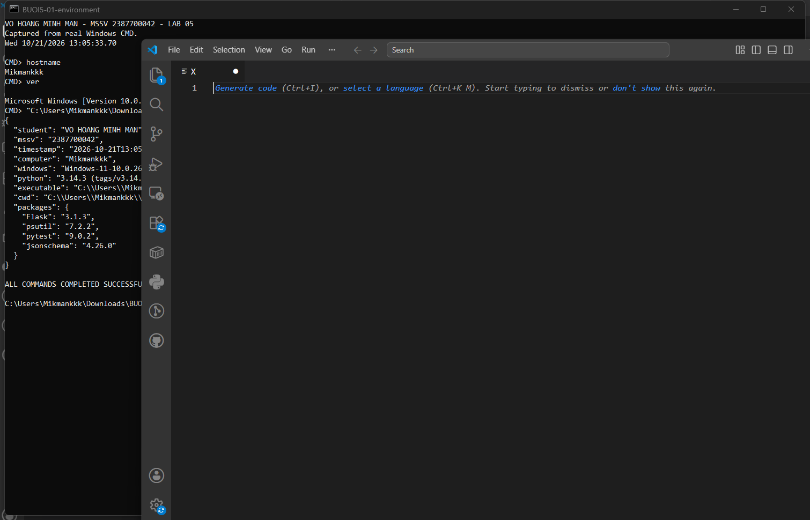
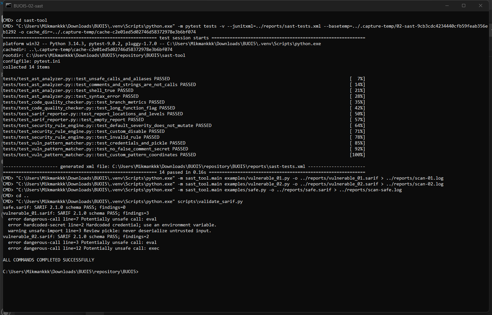
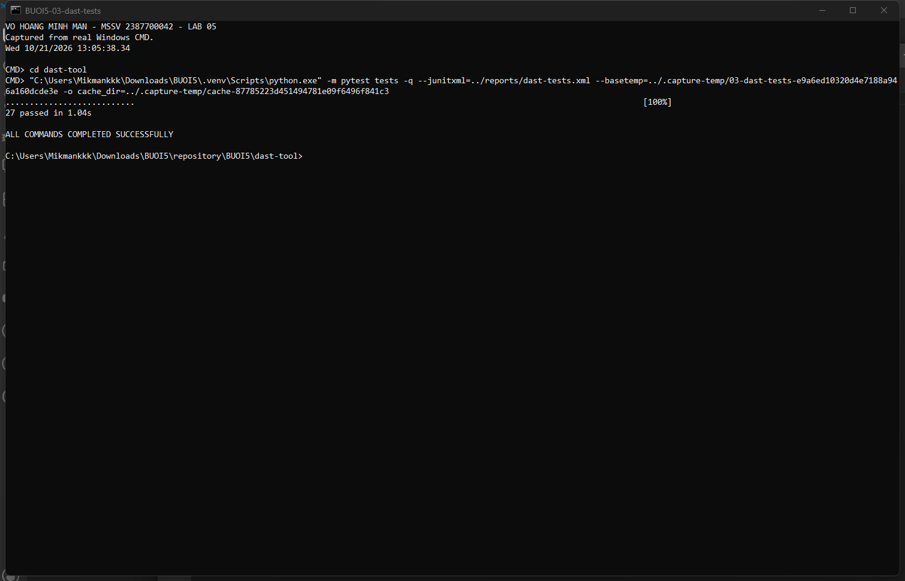
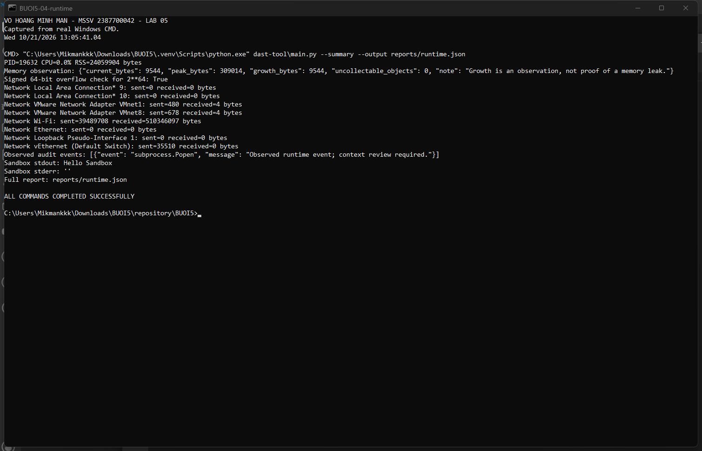
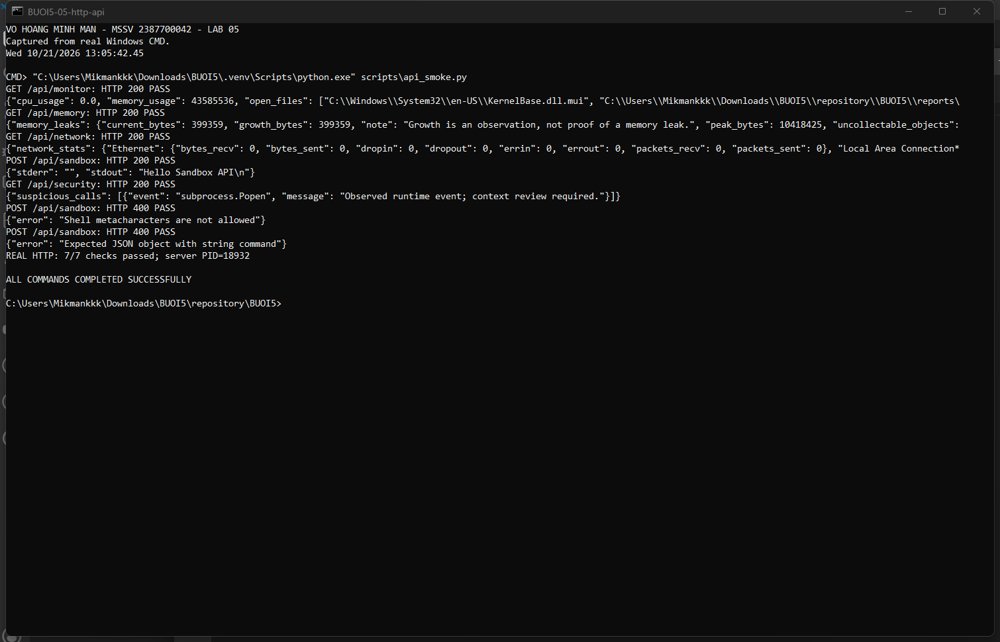
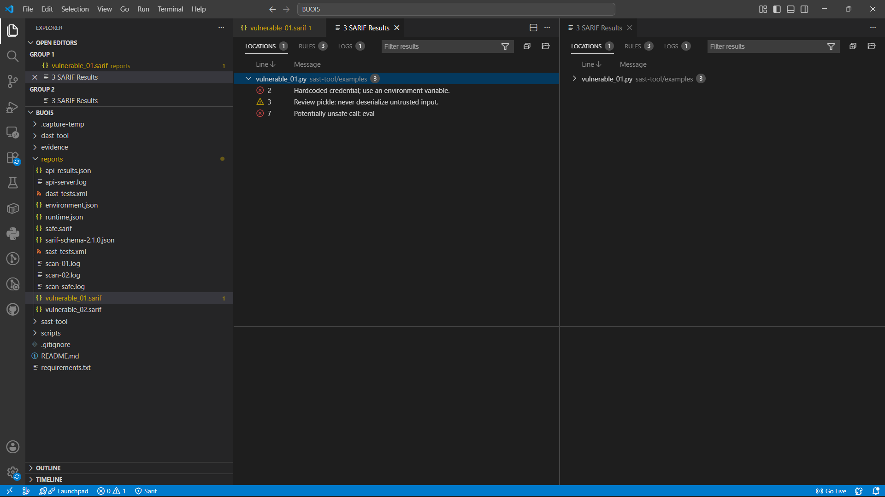

# Bài 5 — Phân tích và kiểm thử bảo mật (SAST & DAST)

**Họ và tên: Võ Hoàng Minh Mẫn**  
**MSSV: 2387700042**  
Môn học: Thực hành Lập trình An toàn thông tin.  
Đề thực hiện: `lab-05.docx`, hai phần SAST-TOOL và DAST-TOOL.

## 1. Kết quả thực nghiệm

Chạy trực tiếp trên máy Windows có hostname **Mikmankkk**, Python **3.14.3**. Ngày giờ trong ảnh lấy từ đồng hồ máy khi thực thi; thông tin môi trường đầy đủ nằm trong [environment.json](reports/environment.json).

| Hạng mục | Kết quả | Tệp đối chiếu |
|---|---|---|
| Unit test SAST | **14/14 PASS** | [JUnit SAST](reports/sast-tests.xml) |
| Unit test DAST và Flask | **27/27 PASS** | [JUnit DAST](reports/dast-tests.xml) |
| HTTP thật qua localhost | **7/7 PASS** | [JSON kết quả API](reports/api-results.json), [log Flask](reports/api-server.log) |
| `vulnerable_01.py` | **3 phát hiện** | [SARIF](reports/vulnerable_01.sarif), [log phân tích](reports/scan-01.log) |
| `vulnerable_02.py` | **2 phát hiện** | [SARIF](reports/vulnerable_02.sarif), [log phân tích](reports/scan-02.log) |
| `safe.py` sau khắc phục | **0 phát hiện theo các rule hiện có** | [SARIF](reports/safe.sarif), [log phân tích](reports/scan-safe.log) |
| Xác thực báo cáo | **3/3 hợp lệ SARIF 2.1.0** | [Script kiểm tra schema](scripts/validate_sarif.py) |
| Giám sát tiến trình thật | CPU, RSS, bộ nhớ Python, bộ đếm mạng, audit event, tiến trình con | [runtime.json](reports/runtime.json) |

## 2. Minh chứng màn hình thật

Các ảnh dưới đây được chụp từ cửa sổ **Windows CMD thực sự chạy lệnh trên máy**, bằng `System.Drawing.Graphics.CopyFromScreen`. Không dùng hình trong đề làm minh chứng và không dựng ảnh terminal. Tên không dấu trong CMD giúp hiển thị ổn định với bảng mã console; thông tin sinh viên đầy đủ có dấu ở đầu báo cáo này.

Script [capture-evidence.ps1](scripts/capture-evidence.ps1) mở CMD, thực thi các lệnh, kiểm tra mã thoát rồi chụp cửa sổ. [sha256.json](evidence/sha256.json) lưu SHA-256 của bộ ảnh để đối chiếu tính toàn vẹn.

### 2.1. Máy thực hiện và thư viện

`hostname`, `ver`, đường dẫn Python, thư mục chạy, phiên bản thư viện và thời gian lấy trực tiếp từ máy:



### 2.2. SAST: kiểm thử, phân tích và xác thực SARIF

Chạy unit test, phân tích cả hai file không an toàn và file đã sửa, sau đó xác thực JSON theo schema SARIF:



### 2.3. DAST: unit test

Kiểm thử tiến trình thật, cấp phát bộ nhớ, giới hạn số nguyên, truyền UDP loopback, audit hook, tiến trình con và Flask API:



### 2.4. DAST: giám sát lúc chạy

PID, CPU, RSS và lưu lượng mạng là số đo tại lần chạy, không phải giá trị điền sẵn. Audit hook ghi nhận `subprocess.Popen` khi chạy demo `Hello Sandbox`:



### 2.5. Flask API: HTTP thật

Script khởi động `app.py`, gửi HTTP thật đến `127.0.0.1:5000`, kiểm tra status và nội dung, lưu JSON/log rồi dừng server. Có cả trường hợp hợp lệ HTTP 200 và đầu vào bị từ chối HTTP 400:



### 2.6. Mở báo cáo bằng SARIF Viewer

Đã cài SARIF Viewer **3.4.5** trong VS Code và mở `vulnerable_01.sarif`; bảng kết quả nhận **3 SARIF Results** và ánh xạ về file nguồn:



## 3. Cấu trúc bài làm

```text
BUOI5/
├── README.md
├── requirements.txt
├── sast-tool/
│   ├── examples/                  # Hai mẫu cố ý có lỗi + mẫu đã sửa
│   ├── rules/default_rules.json   # Luật có thể cấu hình
│   ├── sast_tool/
│   │   ├── ast_analyzer.py
│   │   ├── vuln_pattern_matcher.py
│   │   ├── security_rule_engine.py
│   │   ├── code_quality_checker.py
│   │   ├── sarif_reporter.py
│   │   └── main.py
│   └── tests/
├── dast-tool/
│   ├── runtime_monitor.py
│   ├── memory_analyzer.py
│   ├── network_traffic_analyzer.py
│   ├── security_behavior_checker.py
│   ├── virtual_sandbox.py
│   ├── main.py
│   ├── app.py
│   └── tests/
├── scripts/                       # Kiểm tra HTTP, môi trường, SARIF, chụp CMD
├── reports/                       # Báo cáo thật và schema dùng xác thực
└── evidence/                      # Ảnh chụp CMD + SHA-256
```

## 4. SAST-TOOL

| Thành phần | Chức năng đã triển khai |
|---|---|
| `ASTAnalyzer` | Duyệt cây AST; tìm `eval`, `exec`, `os.system`, `pickle.load(s)` và `subprocess` dùng `shell=True`; nhận diện alias import cơ bản. Không thực thi mã được phân tích. |
| `VulnPatternMatcher` | Tìm thông tin xác thực ghi cứng và import `pickle` bằng AST; hỗ trợ thêm regex tùy chỉnh qua constructor, kèm dòng/cột. |
| `SecurityRuleEngine` | Đọc JSON, ánh xạ severity, cho phép tắt rule bằng `enabled: false`, kiểm tra ID trùng và severity sai; không sửa dữ liệu đầu vào. |
| `CodeQualityChecker` | Đo độ dài hàm, độ phức tạp nhánh, độ sâu lồng và số câu lệnh import. Cảnh báo khi complexity > 10, length > 50 hoặc nesting > 4. |
| `SarifReporter` | Xuất SARIF 2.1.0 với ruleId, severity, đường dẫn nguồn tương đối từ báo cáo, dòng/cột bắt đầu từ 1. |

### Phân tích các phát hiện

| File | Vị trí | Vấn đề | Khắc phục |
|---|---|---|---|
| `vulnerable_01.py` | Dòng 2 | Credential ghi cứng | Dùng biến môi trường hoặc kho quản lý bí mật. Chuỗi trong bài chỉ là dữ liệu giả `DEMO_ONLY_NOT_A_REAL_PASSWORD`. |
| `vulnerable_01.py` | Dòng 3 | Import `pickle` cần rà soát | Không giải tuần tự dữ liệu không tin cậy bằng pickle; cân nhắc JSON. Import đơn thuần chưa chứng minh có khai thác. |
| `vulnerable_01.py` | Dòng 7 | `eval(data)` | Tránh thực thi biểu thức đầu vào; nếu chỉ cần literal, dùng `ast.literal_eval` và kiểm tra kích thước/kiểu theo nghiệp vụ. |
| `vulnerable_02.py` | Dòng 3 | `eval(user_input)` | Thay bằng bộ phân tích dữ liệu hoặc phép toán được cho phép. |
| `vulnerable_02.py` | Dòng 12 | `exec(code)` | Bỏ thực thi mã tùy ý, dùng hàm nghiệp vụ cố định. |

File [safe.py](sast-tool/examples/safe.py) minh họa thay `eval` bằng `ast.literal_eval`, lấy credential từ môi trường và loại bỏ `exec`/pickle. Kết quả 0 cảnh báo chỉ áp dụng cho tập luật hiện tại, không khẳng định chương trình an toàn tuyệt đối. Hàm `read_file` trong mẫu 02 vẫn cần kiểm soát đường dẫn nếu đưa vào ứng dụng nhận dữ liệu từ người dùng; bộ luật này chưa thực hiện taint analysis.

## 5. DAST-TOOL

| Thành phần | Chức năng và giới hạn |
|---|---|
| `RuntimeMonitor` | Dùng psutil đọc CPU, RSS và danh sách file mở của PID thật. |
| `MemoryAnalyzer` | Dùng tracemalloc/GC lấy số byte hiện tại, đỉnh và tăng trưởng so với baseline. Tăng trưởng chưa đủ kết luận rò rỉ; overflow là kiểm tra miền số nguyên signed 64-bit, không phải phát hiện ghi tràn vùng nhớ native. |
| `NetworkTrafficAnalyzer` | Bộ đếm byte/gói gửi nhận theo card mạng từ hệ điều hành; là thống kê toàn máy, chưa bắt nội dung gói hay quy lưu lượng về từng ứng dụng. |
| `SecurityBehaviorChecker` | Ghi nhận audit event thực sự của Python: `exec`, `os.system`, `subprocess.Popen`, `socket.connect`; lưu tối đa 200 sự kiện, chỉ thu thập khi được bật trên thread đang theo dõi. Sự kiện cần xem ngữ cảnh, không tự kết luận mã độc. |
| `VirtualSandbox` | Demo chạy tiến trình Python con với `-I`, `shell=False`, thư mục tạm được dọn tự động, timeout và chỉ chấp nhận `echo <text>` không có shell metacharacter. Đây là runner hạn chế của bài lab, **chưa phải sandbox cách ly hệ điều hành/VM**. |

So với đoạn mẫu trong đề, việc chỉ đổi thư mục làm việc hoặc dò chuỗi trong chính mã nguồn không đảm bảo cách ly hay quan sát runtime. Bài làm dùng audit event thật và giới hạn lệnh demo; không dùng runner này để chạy mã độc. Muốn kiểm tra chương trình không tin cậy cần VM hoặc cơ chế cô lập hệ điều hành riêng.

Flask chỉ lắng nghe `127.0.0.1`, tắt debug. API sandbox không nhận lệnh hệ thống tùy ý.

| Method | Endpoint | Kết quả |
|---|---|---|
| GET | `/api/monitor` | CPU, RSS và file mở của server |
| GET | `/api/memory` | Quan sát bộ nhớ và kiểm tra giới hạn int64 |
| GET | `/api/network` | Thống kê mạng theo interface |
| GET | `/api/security` | Audit event đã ghi trong lần chạy |
| POST | `/api/sandbox` | Nhận JSON `{"command":"echo Hello Sandbox"}`, trả stdout/stderr |

## 6. Cài đặt và chạy lại bằng CMD

Đứng tại thư mục `BUOI5` trong repository đã clone. Các lệnh sau tạo môi trường riêng tại đây; đường dẫn Python tuyệt đối trong ảnh là môi trường đã dùng khi thực hiện bài trên máy.

```bat
python -m venv .venv
.venv\Scripts\python.exe -m pip install -r requirements.txt
mkdir .capture-temp
cd sast-tool
..\.venv\Scripts\python.exe -m pytest tests -v --basetemp=../.capture-temp/sast -o cache_dir=../.capture-temp/sast-cache
..\.venv\Scripts\python.exe -m sast_tool.main examples/vulnerable_01.py -o ../reports/vulnerable_01.sarif
..\.venv\Scripts\python.exe -m sast_tool.main examples/vulnerable_02.py -o ../reports/vulnerable_02.sarif
..\.venv\Scripts\python.exe -m sast_tool.main examples/safe.py -o ../reports/safe.sarif
cd ..
.venv\Scripts\python.exe scripts\validate_sarif.py
cd dast-tool
..\.venv\Scripts\python.exe -m pytest tests -v --basetemp=../.capture-temp/dast -o cache_dir=../.capture-temp/dast-cache
..\.venv\Scripts\python.exe main.py --summary --output ../reports/runtime.json
cd ..
.venv\Scripts\python.exe scripts\api_smoke.py
```

`--basetemp` và cache riêng tránh xung đột quyền với thư mục pytest cũ của tài khoản khác. Chỉ dùng các thư mục tạm dành riêng cho kiểm thử với tùy chọn này.

Chạy Flask để kiểm tra thủ công:

```bat
cd dast-tool
..\.venv\Scripts\python.exe app.py
```

Mở CMD thứ hai:

```bat
curl.exe http://127.0.0.1:5000/api/monitor
curl.exe http://127.0.0.1:5000/api/memory
curl.exe http://127.0.0.1:5000/api/network
curl.exe http://127.0.0.1:5000/api/security
curl.exe -X POST http://127.0.0.1:5000/api/sandbox -H "Content-Type: application/json" -d "{\"command\":\"echo Hello Sandbox\"}"
```

Xem báo cáo bằng **SARIF Viewer** trong VS Code: cài extension `MS-SarifVSCode.sarif-viewer`, mở file `reports/vulnerable_01.sarif`, chọn mở SARIF trong bảng SARIF Viewer; các kết quả chỉ đến file nguồn trong `sast-tool/examples`. Schema dùng xác thực được tải từ [SARIF 2.1.0 JSON Schema](https://json.schemastore.org/sarif-2.1.0.json) và lưu cùng báo cáo để có thể kiểm tra lại offline.

## 7. Ghi chú về dữ liệu và phạm vi

Không đưa credential, token GitHub, file `.env` hoặc môi trường ảo lên repository. Các mẫu có lỗ hổng là dữ liệu phục vụ phân tích tĩnh và chỉ chứa credential giả. Ảnh/log có hostname, đường dẫn dự án và số đo tài nguyên của máy để đáp ứng yêu cầu minh chứng thực tế. Không quét hệ thống bên ngoài; các HTTP/UDP thử nghiệm chạy trên loopback của máy thực hiện.
