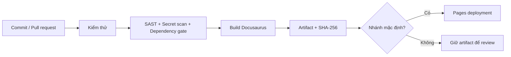
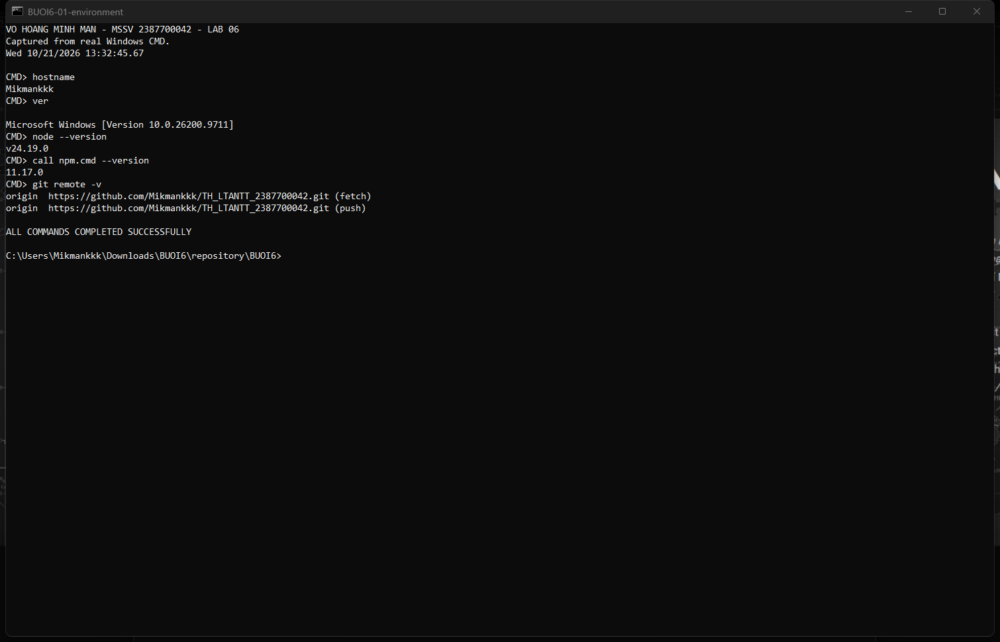
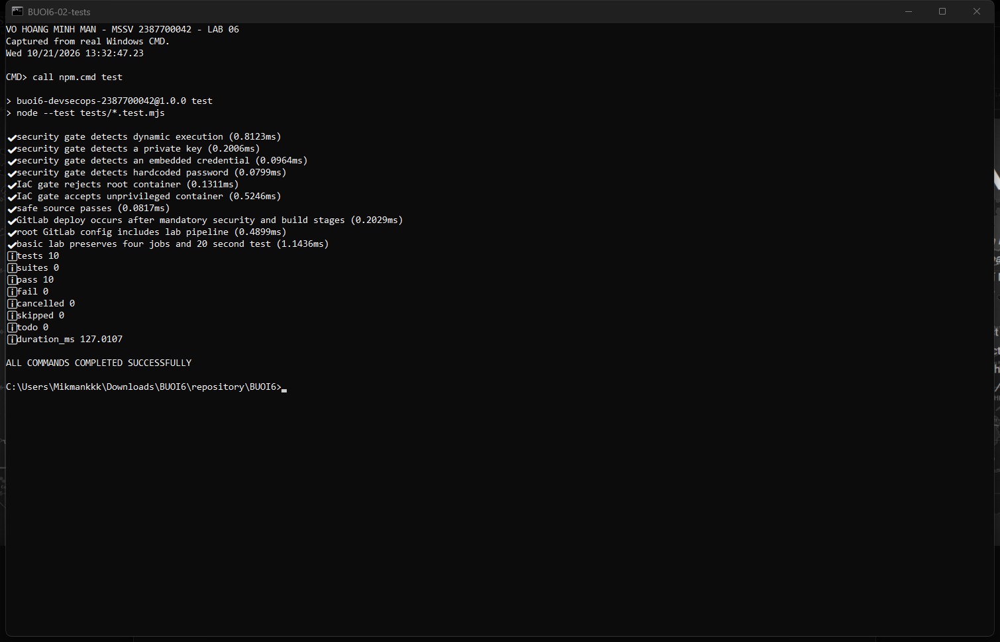
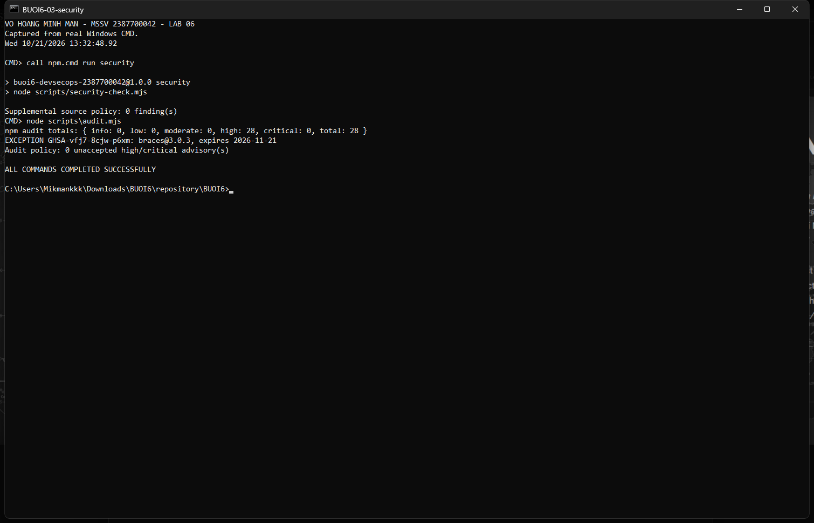
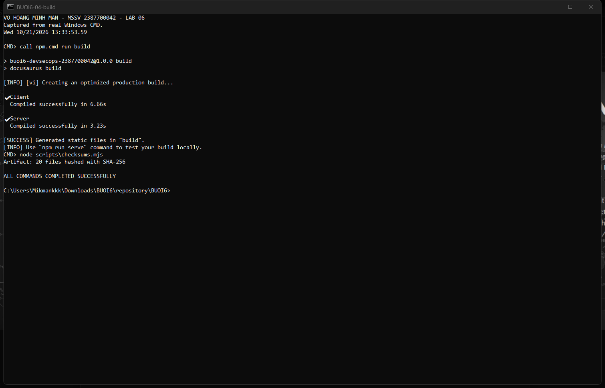
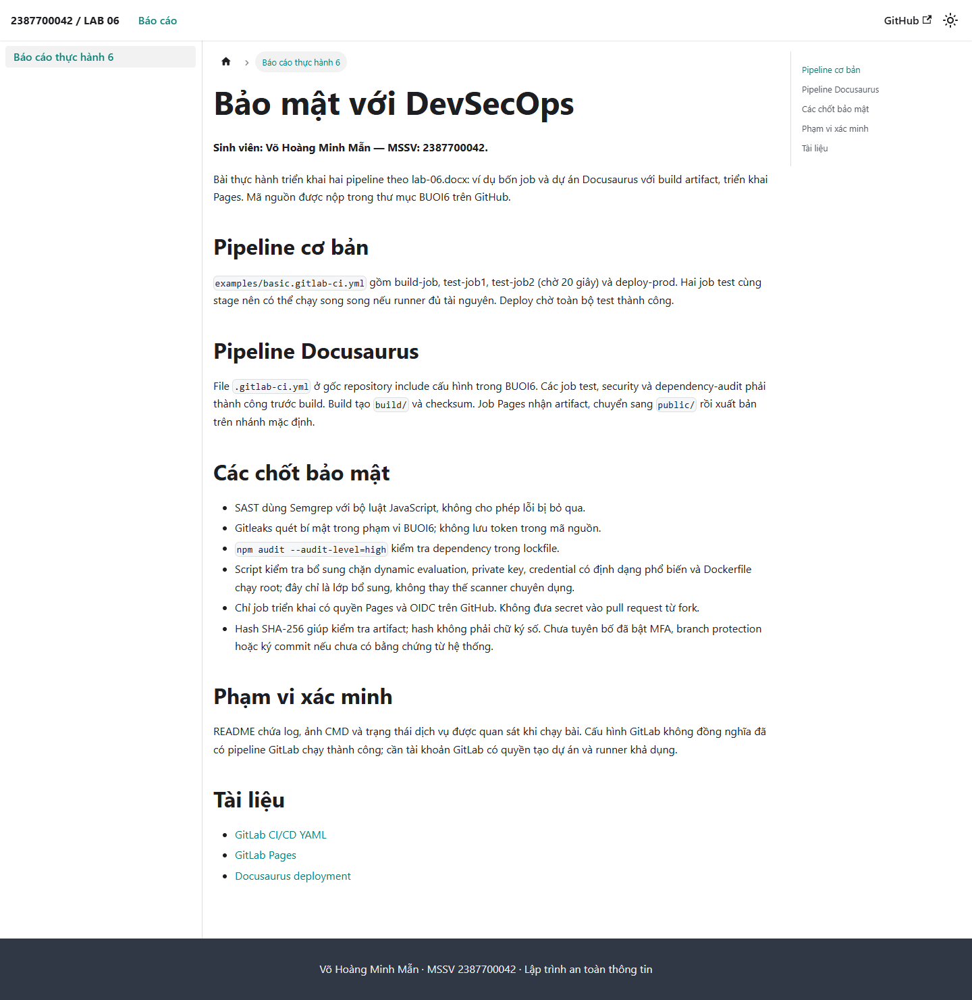
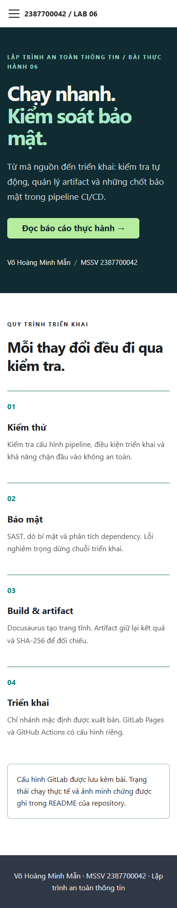
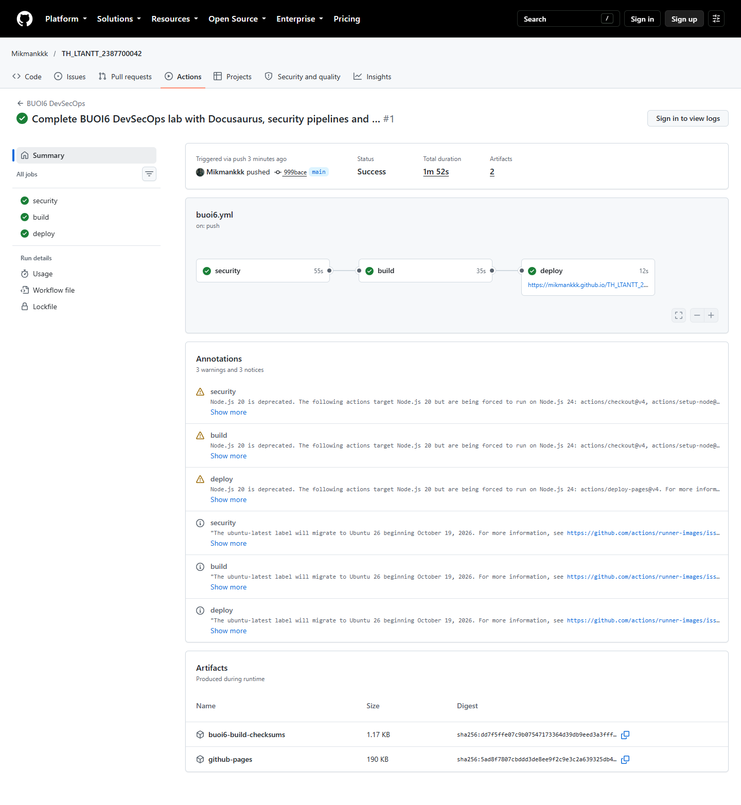
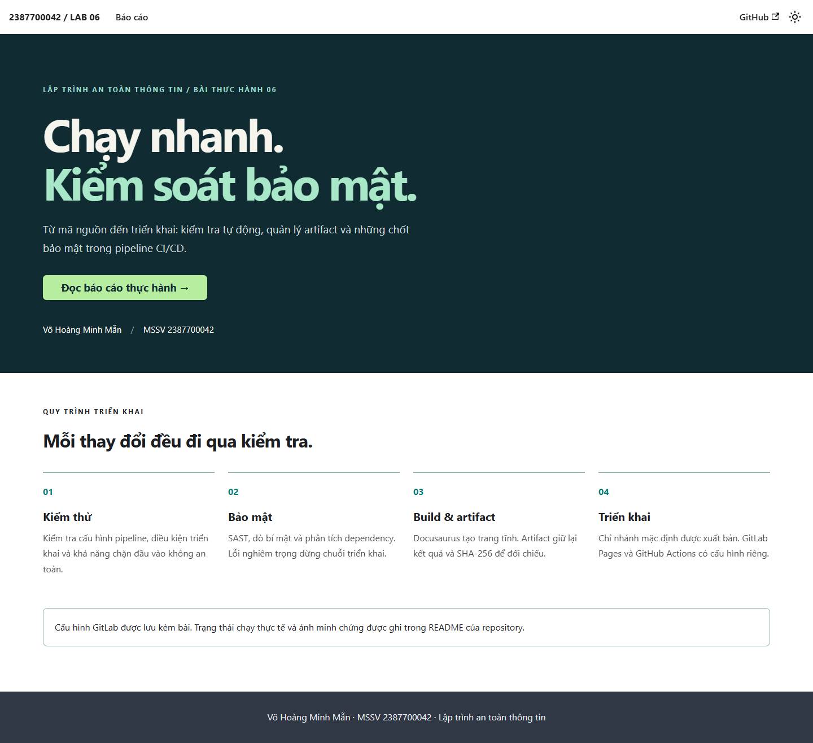

# BUỔI 6 — BẢO MẬT VỚI DEVSECOPS

**Họ và tên: VÕ HOÀNG MINH MẪN**  
**MSSV: 2387700042**  
Môn: Lập trình an toàn thông tin. Đề bài: `lab-06.docx`.

[](https://github.com/Mikmankkk/TH_LTANTT_2387700042/actions/workflows/buoi6.yml)

- [Mã nguồn bài 6](https://github.com/Mikmankkk/TH_LTANTT_2387700042/tree/main/BUOI6)
- [Trang Docusaurus trên GitHub Pages](https://mikmankkk.github.io/TH_LTANTT_2387700042/)
- [Lịch sử pipeline thực tế](https://github.com/Mikmankkk/TH_LTANTT_2387700042/actions/workflows/buoi6.yml)

**Đã xác minh triển khai:** [run #39556402812](https://github.com/Mikmankkk/TH_LTANTT_2387700042/actions/runs/39556402812) của commit `999bace` hoàn tất **success**, cả ba job **security / build / deploy** đều thành công. URL website trả **HTTP 200**. [Bản ghi API](reports/github-run.json). Run này kiểm tra commit triển khai; các cập nhật minh chứng sau đó chỉ bổ sung báo cáo và script đọc trạng thái.

## 1. Đối chiếu yêu cầu đề

| Nội dung lab-06.docx | Tệp triển khai / kết quả |
|---|---|
| Job đầu tiên: echo và date | [examples/first.gitlab-ci.yml](examples/first.gitlab-ci.yml) |
| Pipeline cơ bản bốn job, ba stage | [examples/basic.gitlab-ci.yml](examples/basic.gitlab-ci.yml), có test-job2 chờ 20 giây |
| Dự án Docusaurus, cấu hình url/baseUrl | [package.json](package.json), [docusaurus.config.js](docusaurus.config.js), [src/pages/index.jsx](src/pages/index.jsx) |
| Build website bằng Node.js | `npm ci` và `npm run build`, tạo `build/` |
| Lưu và chuyển artifact | build-job lưu `BUOI6/build/`; pages nhận artifact, chuyển thành `public/` |
| Triển khai GitLab Pages | [.gitlab-ci.yml](.gitlab-ci.yml), được include từ [cấu hình ở gốc repo](../.gitlab-ci.yml) |
| Tích hợp bảo mật | test, Semgrep SAST, Gitleaks, dependency audit, chặn deploy khi gate thất bại |
| Nộp bài trên GitHub | [.github/workflows/buoi6.yml](../.github/workflows/buoi6.yml), build và triển khai GitHub Pages |
| Ảnh minh chứng khi thực hiện | Ảnh chụp CMD thật và trình duyệt trong [evidence/](evidence/) |

**Phạm vi xác minh:** máy đã kết nối GitHub bằng tài khoản Mikmankkk và có quyền push. Không có credential GitLab trong môi trường thực hiện; vì vậy chưa tạo được dự án, chạy runner hay xuất bản GitLab Pages trên GitLab.com. Cấu hình GitLab được triển khai đầy đủ trong repo; ảnh CMD và kết quả GitHub không được trình bày như bằng chứng đã chạy GitLab. Docker Desktop trên máy chưa chạy; Semgrep/Gitleaks được thực thi trên runner GitHub có Docker.

## 2. Thiết kế pipeline



GitLab dùng các stage `test → security → build → deploy`. Các job security không có `allow_failure`; build chờ toàn bộ stage trước thành công. GitHub dùng `needs: security` và `needs: build`. Pull request được kiểm tra và build, chỉ nhánh main được deploy.

Runner dùng môi trường riêng của từng job. Quyền GitHub mặc định chỉ `contents: read`; riêng deploy có `pages: write` và `id-token: write`. Token truy cập API được lấy từ Git Credential Manager, chỉ giữ trong bộ nhớ; không được ghi vào repo hoặc ảnh. Không dùng `pull_request_target`, không truyền credential cho mã từ fork.

Ảnh và log giúp kiểm toán. Artifact có SHA-256 để đối chiếu tính toàn vẹn, **không thay thế chữ ký số**. MFA, protected branches, ký commit và ký artifact là yêu cầu tăng cường cần cấu hình riêng; bài không tuyên bố đã bật các cơ chế tài khoản này.

## 3. Kết quả kiểm chứng và xử lý dependency

- **10/10 kiểm thử đạt**: phát hiện dynamic execution, private key, credential, mật khẩu cứng; kiểm tra Dockerfile root/non-root; mã an toàn; quan hệ gate/deploy, include pipeline và đủ bốn job mẫu. [Log](reports/tests.log).
- **Build production thành công**, tạo trang HTML và static assets; [SHA-256 artifact](reports/build-sha256.json).
- **5 kiểm tra trình duyệt đạt**: HTTP 200, heading, điều hướng đến báo cáo, mobile không tràn ngang, không có lỗi JavaScript. [Báo cáo](reports/browser.json).
- Kiểm tra source bổ sung: **0 finding**, [security.json](reports/security.json). Script này có phạm vi hạn chế, không thay thế Semgrep hoặc Gitleaks.
- Audit lần đầu: **45 dependency bị báo cáo**, gồm **16 critical, 14 high, 15 moderate**. [audit-before.json](reports/audit-before.json).
- Đã cập nhật qua `overrides`: tinypool 2.2.0, serialize-javascript 7.1.2, postcss-selector-parser 7.1.7 và uuid của sockjs 11.1.1. Build được chạy lại sau cập nhật.
- Audit sau cập nhật: **0 critical, 0 moderate, 28 high**. Những mục high là cùng một advisory của `braces` được lan truyền lên các package phụ thuộc, **không phải 28 advisory độc lập**. [audit-after.json](reports/audit-after.json).
- `braces@3.0.3`: [GHSA-vfj7-8cjw-p6xm](https://github.com/advisories/GHSA-vfj7-8cjw-p6xm), chưa có bản vá upstream tại ngày thực hiện. Chấp nhận ngoại lệ hẹp cho build với pattern do repository kiểm soát; website triển khai chỉ phục vụ file tĩnh. Ngoại lệ hết hạn **21/11/2026**, chỉ khớp đúng advisory, tên package và phiên bản. Advisory mới hoặc ngoại lệ quá hạn làm gate thất bại. [Chính sách](security-exceptions.json), [kết quả gate](reports/audit-policy.json). **Không tuyên bố dependency đã sạch lỗ hổng.**

## 4. Ảnh minh chứng thực hiện

Ảnh CMD được chụp trực tiếp từ cửa sổ Windows bằng `CopyFromScreen`, sau khi các lệnh thực tế hoàn tất; không dựng lại terminal từ văn bản. Script có tên sinh viên, MSSV và thời gian chạy. [Script tái tạo ảnh](scripts/capture-evidence.ps1), [hash các ảnh](evidence/sha256.json).

### 4.1. Môi trường và repo từ CMD



### 4.2. Kiểm thử tự động



### 4.3. Security gate và ngoại lệ được công khai



### 4.4. Build production và kiểm tra artifact



### 4.5. Trang Docusaurus chạy trên trình duyệt






### 4.6. Pipeline GitHub và website đã xuất bản





Chạy `node scripts/remote-status.mjs` để đọc trạng thái pipeline và HTTP website, không cần lưu token. Script `node scripts/remote-screenshots.mjs` chụp hai trang công khai bằng Chrome.

## 5. Chạy lại bài trên Windows CMD

Yêu cầu Node.js 22 trở lên (máy thực hiện dùng Node 24). Trong thư mục BUOI6:

```bat
npm ci
npm test
npm run security
node scripts\audit.mjs
npm run build
node scripts\checksums.mjs
npm run serve -- --port 3000
```

Mở `http://127.0.0.1:3000/TH_LTANTT_2387700042/`. Giữ server chạy, mở CMD khác và chạy `node scripts\browser-check.mjs` để kiểm chứng bằng Chrome đã cài. Chụp lại CMD:

```powershell
powershell.exe -NoProfile -ExecutionPolicy Bypass -File scripts\capture-evidence.ps1
```

`npm audit --audit-level=high` thuần vẫn trả lỗi vì advisory braces chưa được vá. Pipeline dùng `node scripts/audit.mjs` để đánh giá ngoại lệ minh bạch; không tắt audit, không hạ ngưỡng toàn cục và không bỏ qua toàn bộ exit code.

## 6. Sử dụng cấu hình trên GitLab

1. Tạo project GitLab và push repository này sang remote GitLab bằng tài khoản có quyền Maintainer/Owner. Giữ nguyên thư mục BUOI6 và file `.gitlab-ci.yml` ở gốc.
2. Trong **Settings → CI/CD → Runners**, xác nhận có Linux runner và đủ quota. Cấu hình chính tự include `BUOI6/.gitlab-ci.yml`.
3. Để chạy ví dụ đầu hoặc ví dụ bốn job độc lập, thay CI/CD configuration file trong Settings bằng `BUOI6/examples/first.gitlab-ci.yml` hoặc `BUOI6/examples/basic.gitlab-ci.yml`; sau đó trả về `.gitlab-ci.yml` để chạy Docusaurus.
4. Trong **Build → Pipelines**, kiểm tra test/security thành công trước build; mở job build để xem artifact, job pages để xem publish. Trong **Deploy → Pages**, lấy URL thực tế.
5. Docusaurus lấy origin và base path từ biến GitLab `CI_PAGES_URL`, tương thích đường dẫn project hoặc unique domain. Nếu đổi lựa chọn unique domain thì chạy lại pipeline để build lại URL.

Nếu đưa riêng nội dung BUOI6 thành repo GitLab mới, cần sửa `cd BUOI6`, đường dẫn artifact/cache/scanner và bỏ bài kiểm tra include cấp cha. Cấu hình nộp ở đây chủ ý dành cho cấu trúc nhiều buổi của repository hiện tại.

## 7. Tài liệu tham khảo

- [GitLab CI/CD YAML reference](https://docs.gitlab.com/ci/yaml/): stages, needs/dependencies, artifacts, rules.
- [GitLab Pages from scratch](https://docs.gitlab.com/user/project/pages/getting_started/pages_from_scratch/): `pages.publish` theo cú pháp hiện hành.
- [Docusaurus deployment](https://docusaurus.io/docs/deployment): url/baseUrl và build website.
- [GitHub Pages custom workflows](https://docs.github.com/en/pages/getting-started-with-github-pages/using-custom-workflows-with-github-pages).
- Đề `lab-06.docx`, Bài 6: Bảo mật với DevSecOps.
